# 動作確認報告
ここでは、調査の結果をもとに実際に作業を記録する。

## 0章 概要
### 0.1節 この手順書でできること
動作確認なし

### 0.2節 必要な機材
動作確認なし

### 0.3節 前提知識・事前準備
動作確認なし


## 1章 開発環境構築
### 1.1節 ツールのインストール
調査報告の表を記載
| ツール名 | カテゴリ | 用途 |
| --- | --- | --- |
| Raspberry Pi Imager | ソフトウェア | microSDカードにRaspberry Pi OSを書き込む |
| Raspberry Pi OS | OS構築 | Raspberry Pi Imagerを使用してmicroSDカードにOSを書き込み、初期設定を行う |
| OpenSSH | コマンドラインツール | Wi-Fi経由のSSH接続によるRaspberry Piの遠隔操作、およびSCPによるPCとRaspberry Pi間のファイル転送 |
| apt | OS標準コマンド | パッケージのインストール・更新・管理を行う |
| build-essential | APTパッケージ | GCCやMakeなど、C言語のコンパイル・ビルドに必要なツールをまとめて導入する |
| libgpiod-dev | APTパッケージ | C言語からGPIOを操作するための開発ライブラリ |
| gdb | APTパッケージ | C言語プログラムのデバッグを行う |
| Python 3 | OS標準ソフト | Pythonプログラムを実行する |
| python3-gpiozero | APTパッケージ | PythonからGPIOを操作するためのライブラリ |
| python3-serial | APTパッケージ | Pythonからシリアル通信を行うためのライブラリ |

#### Raspberry Pi Imager
1. 公式サイトにアクセスする<br>
[Raspberry Pi公式サイト（Software）](https://www.raspberrypi.com/software/)
2. Windows版をダウンロードする<br>
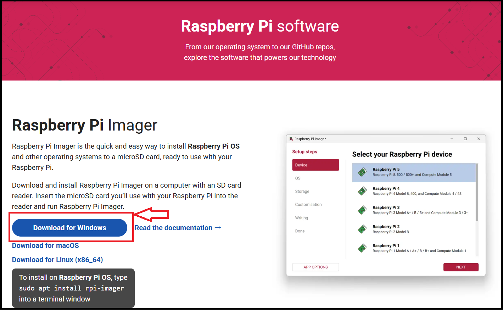
3. インストーラーを実行する<br>
ダウンロードした .exe ファイルをダブルクリックして実行する
4. インストールする<br>
インストール画面の指示に従って操作する

#### Raspberry Pi OS
1. Raspberry Pi Zero WのマイクロSDをPCに挿入する
2. Raspberry Pi Imagerを起動する
3. Deviceを設定する<br>
Raspberry Pi Zeroを選択し、次へを押下する。<br>
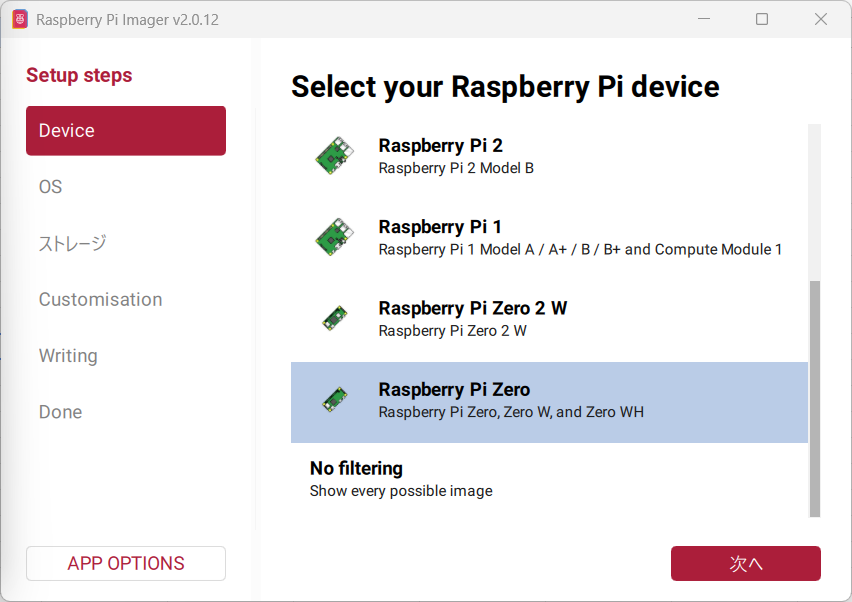
4. OSを設定する<br>
Raspberry Pi OS (32-bit)を選択し、次へを押下する。<br>
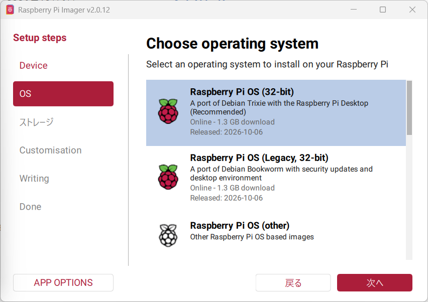
5. ストレージを設定する<br>
表示されているストレージデバイスから選択し、次へを押下する。<br>
**※ Exclude system drivesのチェックはつけておく。**<br>
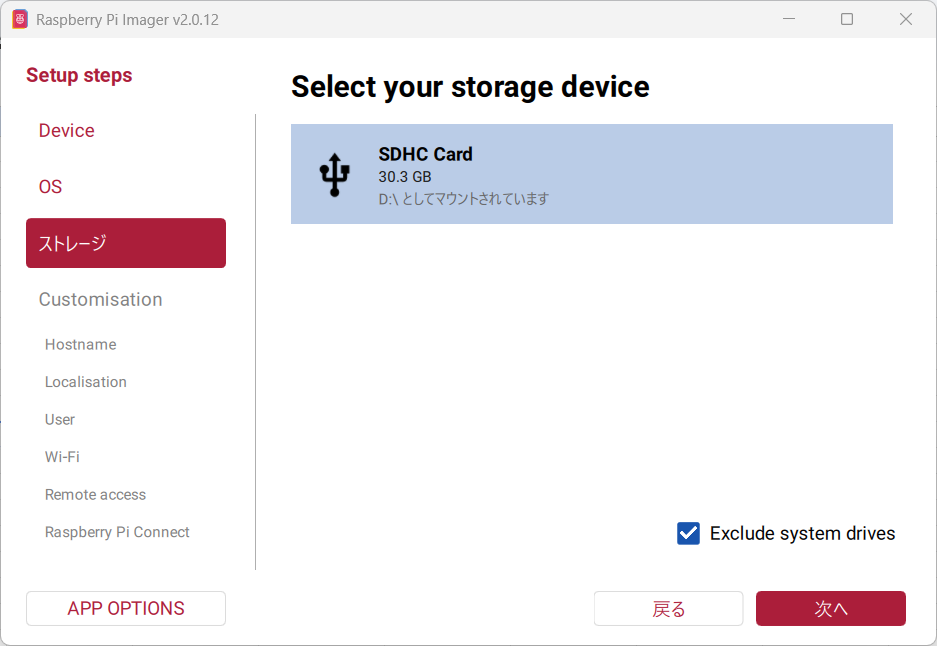
6. hostnameを設定する<br>
文字、数字、ハイフンのみで入力し、次へを押下する。<br>
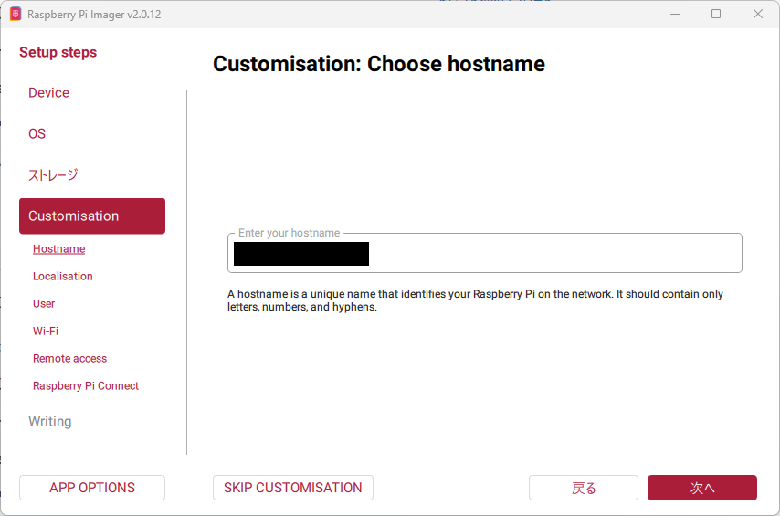
7. Localisationを設定する<br>
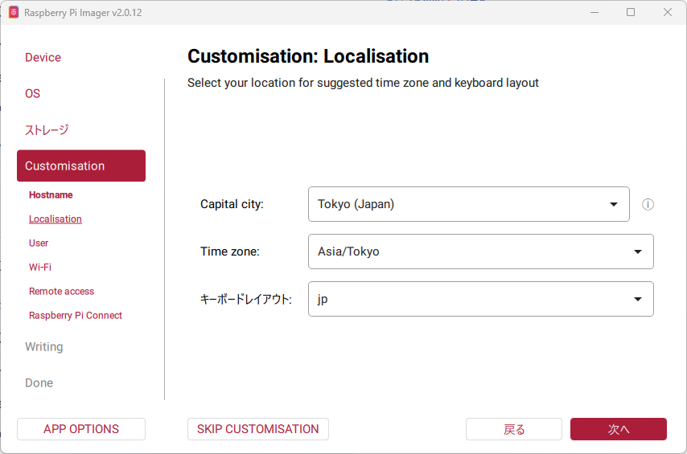
8. usernameを設定する<br>
小文字で、文字、数字、アンダースコア、ハイフンのみで入力、パスワードも入力を行い、次へを押下する。<br>
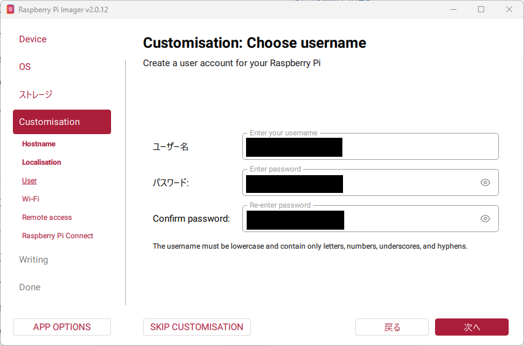
9. Wi-Fiを設定する<br>
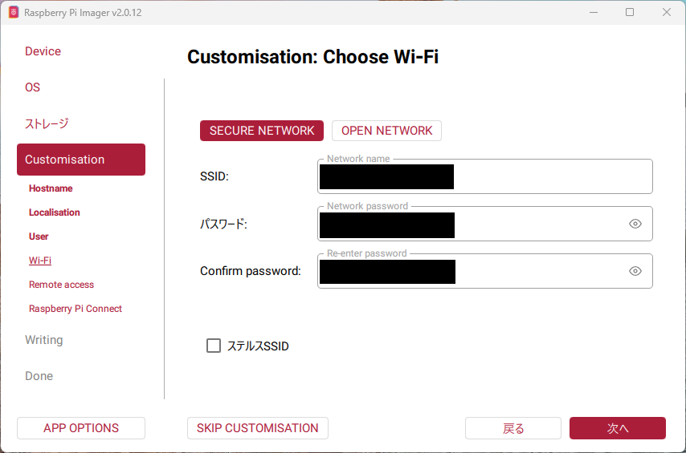
10. SSH authenticationを設定する<br>
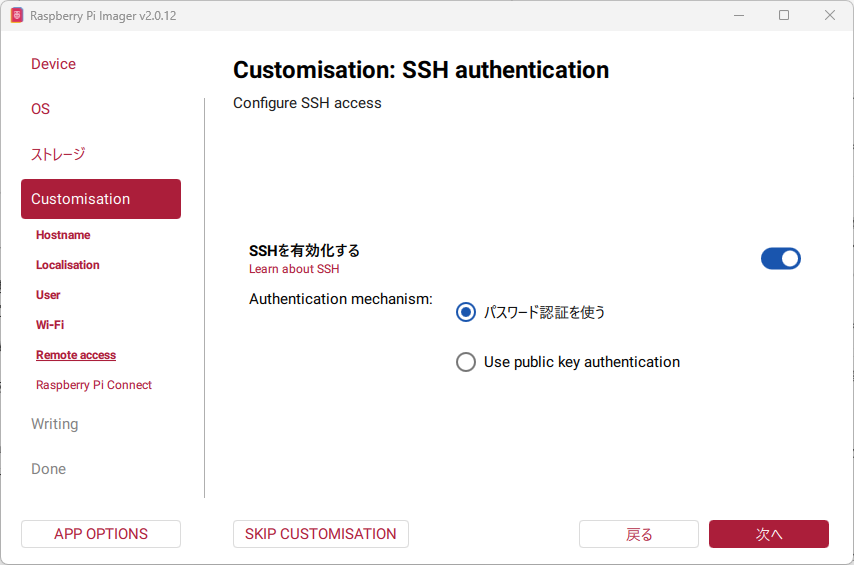
11. Raspberry Pi Connectを設定する<br>
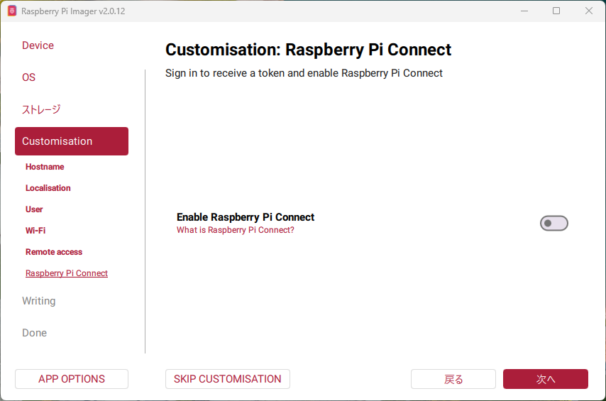
12. Writeを押下し、書き込みを始める<br>
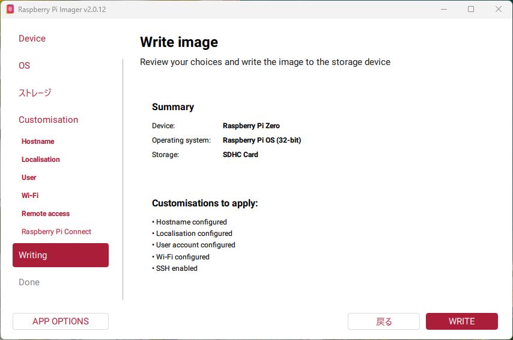
13. I UNDERSTAND, ERASE AND WRITEを押下する<br>
書き込み時に、現在マイクロSDに書かれている内容を削除してから書き込むことを確認されているため、理解していることを伝える。<br>
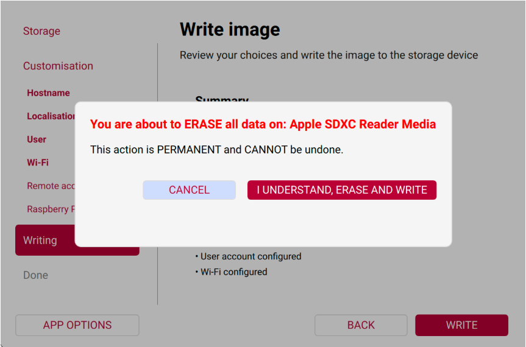
14. 書き込みが終了したらFINISHを押下する<br>
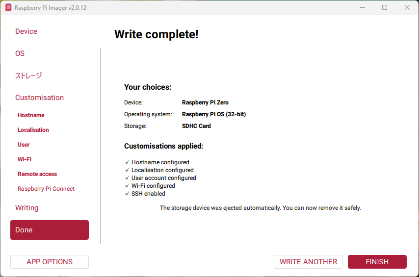
15. マイクロSDカードを抜く

#### OpenSSH
1. 管理者としてPowerShellを開く
2. コマンドを実行する<br>```Add-WindowsCapability -Online -Name OpenSSH.Client~~~~0.0.1.0```

#### apt
aptはRaspberry Pi OSに標準でインストールされているパッケージ管理ツールである。<br>
そのため、ここではインストール済みパッケージの更新方法を記載する。<br>
1. Raspberry Piのターミナルを開く
2. コマンドを実行する<br>```sudo apt full-upgrade```

#### build-essential
1. Raspberry Piのターミナルを開く
2. コマンドを実行する<br>```sudo apt install build-essential```

#### libgpiod-dev
1. Raspberry Piのターミナルを開く
2. コマンドを実行する<br>```sudo apt install libgpiod-dev```

#### gdb
1. Raspberry Piのターミナルを開く
2. コマンドを実行する<br>```sudo apt install gdb```

#### Python 3
aptはRaspberry Pi OSに標準でインストールされている。<br>
万が一インストールされていない場合は、以下を実行する。<br>
1. Raspberry Piのターミナルを開く
2. コマンドを実行する<br>```sudo apt install python3```

#### python3-gpiozero
1. Raspberry Piのターミナルを開く
2. コマンドを実行する<br>```sudo apt install python3-gpiozero```

#### python3-serial
1. Raspberry Piのターミナルを開く
2. コマンドを実行する<br>```sudo apt install python3-serial```

### 1.2節 ドライバのインストール
調査報告の表を記載
| ドライバ名 | 用途 |
| --- | --- |
| USBシリアル変換ドライバ（CH341SER） | PCでCH340Eを認識するため |

#### USBシリアル変換ドライバ
1. WCHの公式サイトにアクセスする
[CH341SER公式ダウンロードページ](CH341SER公式ダウンロードページ)
2. CH341SER.EXE をダウンロードする
3. ダウンロードしたファイルを実行する
4. インストール画面で「INSTALL」をクリックする
5. 「OK」をクリックして画面を閉じる

### 1.3節 インストールできたことの確認
インストールする項目について、どのように確認するかを示す。
工程としては、「確認→インストール→確認」の手順で行うものとする。

| 項目名 | 確認方法 | 確認内容 |
| --- | --- | --- |
| Raspberry Pi Imager | アプリケーション一覧から起動する | 起動できること |
| Raspberry Pi OS | ssh ユーザー名@ホスト名 を実行する | 接続できること |
| OpenSSH | ssh -V を実行する | SSHクライアントのバージョンが表示されること |
| apt | apt --version | aptのバージョンが表示されること |
| build-essential | gcc --version、make --version | GCCとMakeのバージョンが表示されること |
| libgpiod-dev | pkg-config --modversion libgpiod | libgpiodのバージョンが表示されること |
| gdb | gdb --version | GDBのバージョンが表示されること |
| Python 3 | python3 --version | Python 3のバージョンが表示されること |
| python3-gpiozero | python3 -c "import gpiozero; print(gpiozero.__version__)" | GPIO Zeroのバージョンが表示されること |
| python3-serial | python3 -c "import serial; print(serial.__version__)" | pySerialのバージョンが表示されること |
| USBシリアル変換ドライバ（CH341SER） | デバイスマネージャーの「ポート（COMとLPT）」を確認する | 「USB-SERIAL CH340」などのデバイスが表示され、正常に認識されていること |

#### Raspberry Pi Imager
1. アプリを検索する<br>
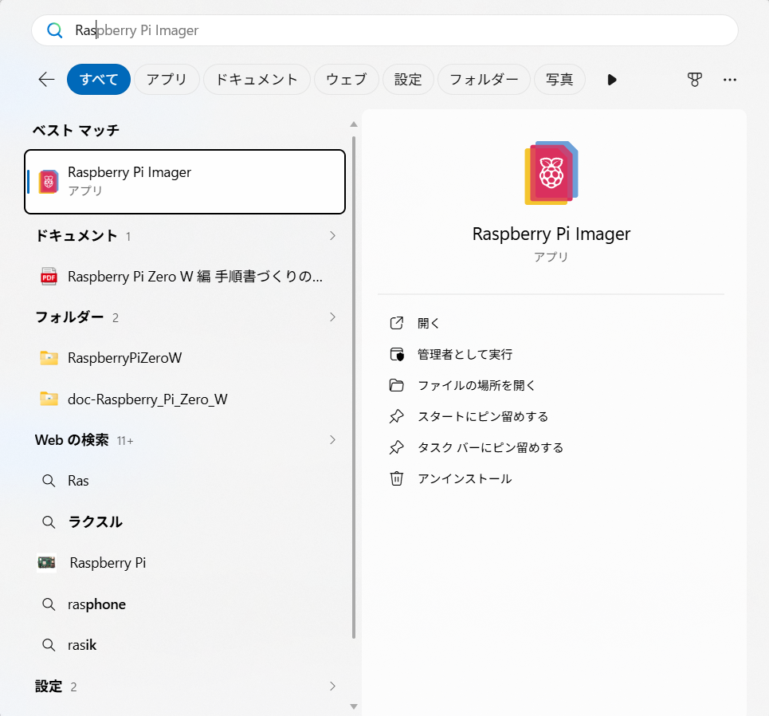
2. 起動する
3. 立ち上がることを確認する<br> 
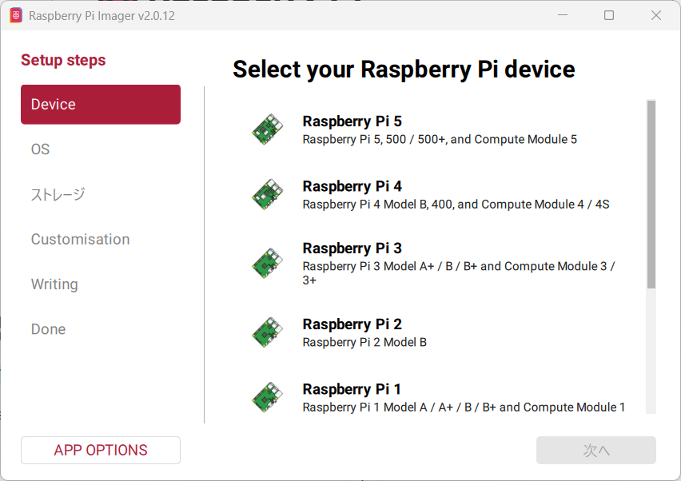

#### Raspberry Pi OS
1. ターミナルを開く
2. コマンドを実行する<br>```ssh ユーザー名@ホスト名```
3. Raspberry Pi Zero Wに接続できることを確認する<br>
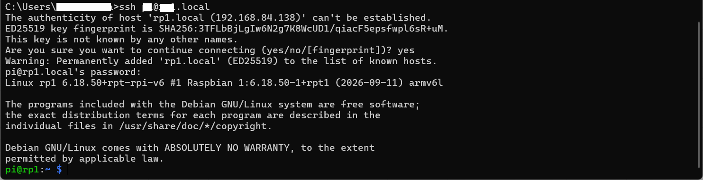

#### OpenSSH
1. ターミナルを開く
2. コマンドを実行する<br>```ssh -V```
3. バージョンが出力されることを確認する

#### apt
1. Raspberry Piのターミナルを開く
2. コマンドを実行する<br>```apt --version```
3. バージョンが出力されることを確認する

#### build-essential
1. Raspberry Piのターミナルを開く
2. gccの確認コマンドを実行する<br>```gcc --version```
3. GCCのバージョンが出力されることを確認する。
4. makeの確認コマンドを実行する<br>```make --version```
5. Makeのバージョンが出力されることを確認する。

#### libgpiod-dev
1. Raspberry Piのターミナルを開く
2. コマンドを実行する<br>```pkg-config --modversion libgpiod```
3. バージョンが出力されることを確認する

#### gdb
1. Raspberry Piのターミナルを開く
2. コマンドを実行する<br>```gdb --version```
3. バージョンが出力されることを確認する

#### Python 3
1. Raspberry Piのターミナルを開く
2. コマンドを実行する<br>```python3 --version```
3. バージョンが出力されることを確認する

#### python3-gpiozero
1. Raspberry Piのターミナルを開く
2. コマンドを実行する<br>```pip3 show gpiozero```
3. パッケージの詳細情報が表示されることを確認する

#### python3-serial
1. Raspberry Piのターミナルを開く
2. コマンドを実行する<br>```pip3 show pyserial```
3. パッケージの詳細情報が表示されることを確認する

#### USBシリアル変換ドライバ
1. CH340EのUSB Type-C端子とPCのUSB端子をUSBケーブルで接続する
2. Windowsのスタートメニューから、「デバイスマネージャー」を開く
3. 「ポート（COMとLPT）」を展開する<br>
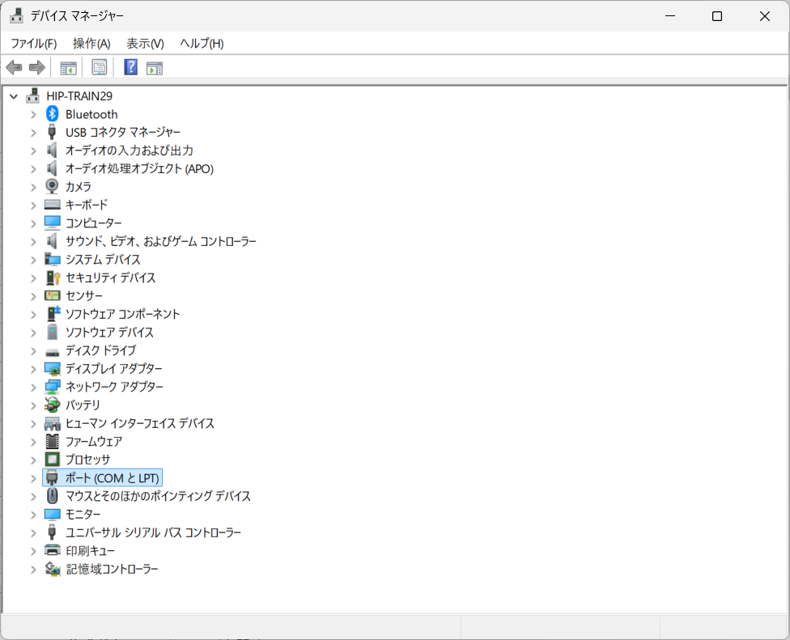
4. 「USB-SERIAL CH340（COM〇）」が表示されることを確認する。<br>
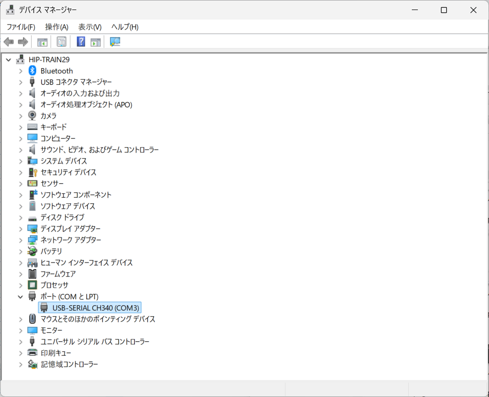


## 2章 シリアルターミナル
### 2.1節 使用するツールと接続方法
#### 使用ツールの選定
動作確認なし

Tera Termのインストールについて手順を示す。
1. 公式ダウンロードページを開く<br>
[Tera Term 公式ダウンロード（GitHub）](https://github.com/TeraTermProject/teraterm/releases)
2. Assetsから「teraterm-バージョン番号-x64.exe」をダウンロード
3. ダウンロードしたファイルをダブルクリックで実行
4. インストールする<br>
インストール画面の指示に従って操作する

#### 接続方法
1. CH340EをPCに接続する
2. Tera Termを起動する<br>

3. 「新しい接続」画面で「シリアル」を選択する<br>
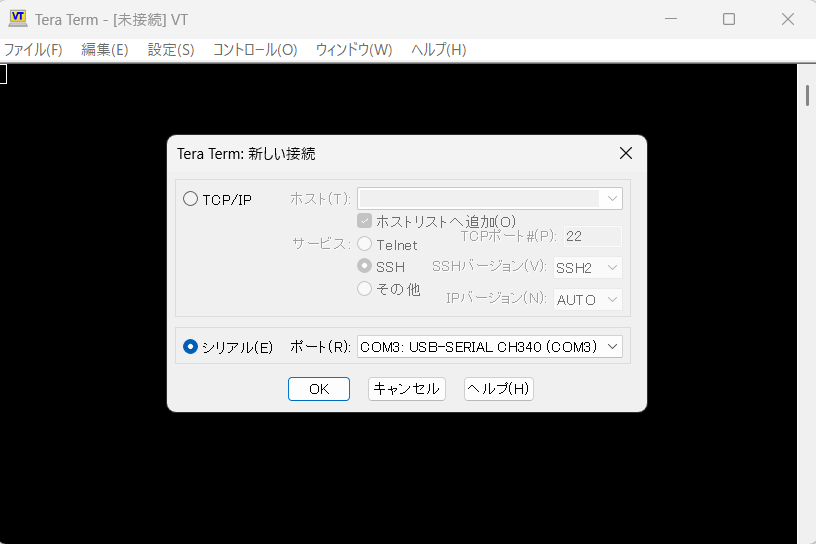
4. 「新しい接続」画面で「シリアル」を選択する<br>
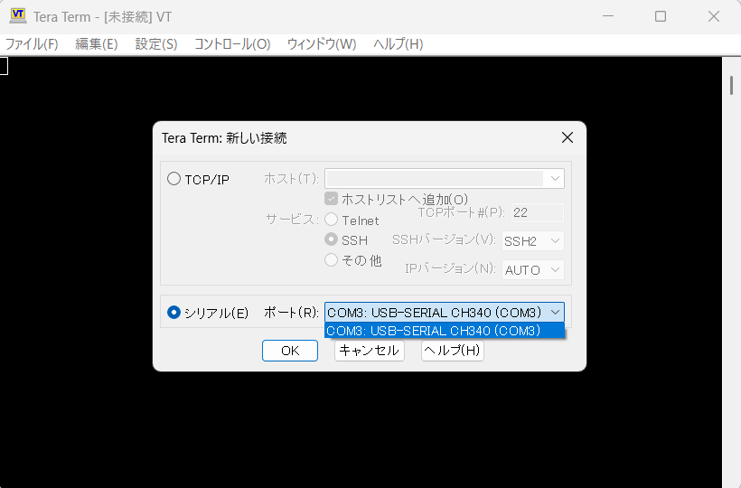
5. 「OK」をクリックする

### 2.2節 通信設定(ポート、ボーレートなど)
動作確認なし

### 2.3節 動作確認
動作確認の手順を示す。

1. Raspberry PiとCH340Eをジャンパワイヤで接続する。<br>つなぎ方は下記「ピン割り当て」を参照すること。
2. CH340EのUSB Type-C端子とPCのUSB端子をUSBケーブルで接続する。
3. Raspberry Piの電源端子に電源ケーブルを接続し、電源を投入する。
4. PCからSSHでRaspberry Piに接続し、ターミナルを開く。<br>
**事前にRaspberry Piのシリアル通信について設定を行っておく必要がある。<br>
シリアル通信の設定については下記、[UARTシリアル通信設定]()を参照すること。**
（ここから手順に「UARTシリアル通信設定」を続けてもいいかも）
5. [接続方法](#接続方法)を参考にTera TermとCH340Eを接続
6. Raspberry Piのターミナルからプログラム「PItoPC_SerialSend」を実行する。<br>
プログラム「PItoPC_SerialSend」は下記にC言語とPythonの2つで記載<br>
**プログラム「PItoPC_SerialSend」は事前に実行ファイルを作成しておく必要がある。<br>
実行ファイルの作成については[2章〇節]()を参照すること。**
7. Tera Termに「Hello PC!」と表示されることを確認する。

#### UARTシリアル通信設定
1. PCからSSHでRaspberry Piに接続し、ターミナルを開く。
2. コマンドを実行する<br>```sudo raspi-config```
3. 「3.Interface Options」を選択する<br>
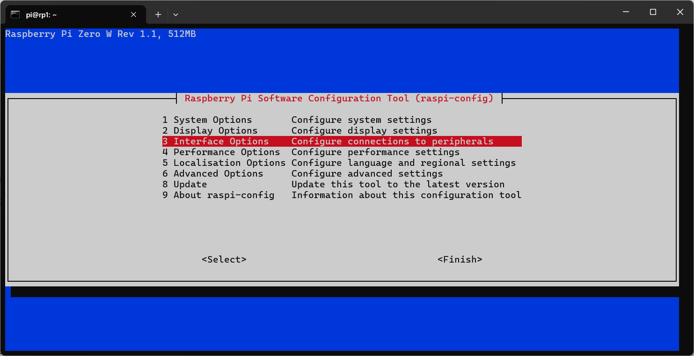
4. 「I6.Serial Port」を選択する<br>
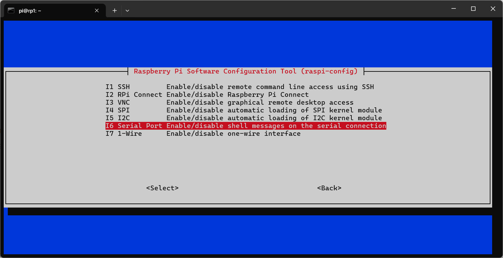
5. 「Would you like a login shell to be accessible over serial?」でNoを選択する<br>
シリアルポートからログインする機能を無効にする<br>
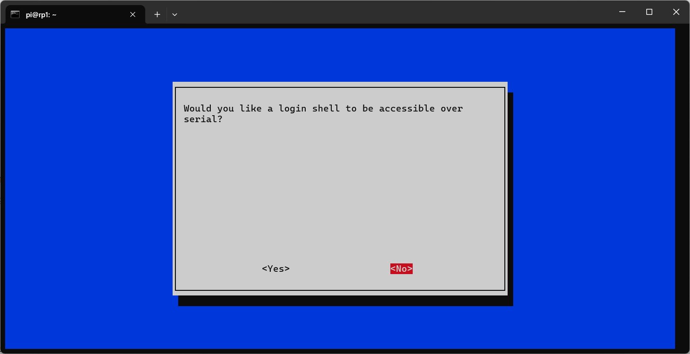
6. 「Would you like the serial port hardware to be enabled?」でYesを選択する<br>
シリアルポートのハードウェアを有効にする<br>
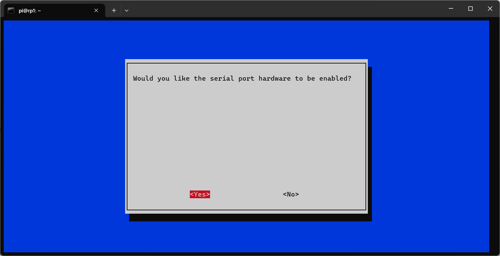

#### ピン割り当て
.png)

#### プログラム「PItoPC_SerialSend」
C言語
```C
#include <stdio.h>
#include <stdlib.h>
#include <string.h>
#include <unistd.h>
#include <fcntl.h>
#include <termios.h>

int main(void)
{
    int serial_fd;
    struct termios tty;
    const char *message = "Hello PC!\r\n";

    // シリアルポートを開く
    serial_fd = open("/dev/serial0", O_WRONLY | O_NOCTTY);

    if (serial_fd < 0)
    {
        perror("シリアルポートを開けませんでした");
        return 1;
    }

    // 現在のシリアル通信設定を取得
    if (tcgetattr(serial_fd, &tty) != 0)
    {
        perror("通信設定を取得できませんでした");
        close(serial_fd);
        return 1;
    }

    // 通信速度を115200bpsに設定
    cfsetispeed(&tty, B115200);
    cfsetospeed(&tty, B115200);

    // 通信形式を設定（8N1）
    tty.c_cflag &= ~PARENB;  // パリティなし
    tty.c_cflag &= ~CSTOPB;  // ストップビット1
    tty.c_cflag &= ~CSIZE;
    tty.c_cflag |= CS8;      // データビット8
    tty.c_cflag |= CLOCAL;   // モデム制御を無効化
    tty.c_cflag |= CREAD;    // 受信を有効化

    // フロー制御を無効化
    tty.c_cflag &= ~CRTSCTS;

    // 入出力処理の設定
    tty.c_iflag = 0;
    tty.c_oflag = 0;
    tty.c_lflag = 0;

    // 通信設定を反映
    if (tcsetattr(serial_fd, TCSANOW, &tty) != 0)
    {
        perror("通信設定を反映できませんでした");
        close(serial_fd);
        return 1;
    }

    printf("シリアル通信を開始しました\n");

    while (1)
    {
        // PCへ文字列を送信
        write(serial_fd, message, strlen(message));

        printf("送信: Hello PC!\n");

        sleep(1);
    }

    // シリアルポートを閉じる
    close(serial_fd);

    return 0;
}
```

Python
```Python
import serial
import time

# シリアル通信の設定
ser = serial.Serial(
    port='/dev/serial0',
    baudrate=115200,
    bytesize=serial.EIGHTBITS,
    parity=serial.PARITY_NONE,
    stopbits=serial.STOPBITS_ONE
)

print("シリアル通信を開始しました")

try:
    while True:
        # PCへ送信する文字列
        message = "Hello PC!"

        # 文字列をシリアル送信
        ser.write((message + "\r\n").encode("utf-8"))

        print("送信:", message)

        time.sleep(1)

except KeyboardInterrupt:
    print("\n送信を終了します")

finally:
    ser.close()
```
