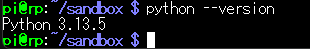
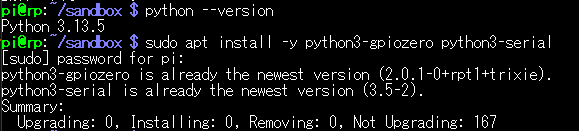
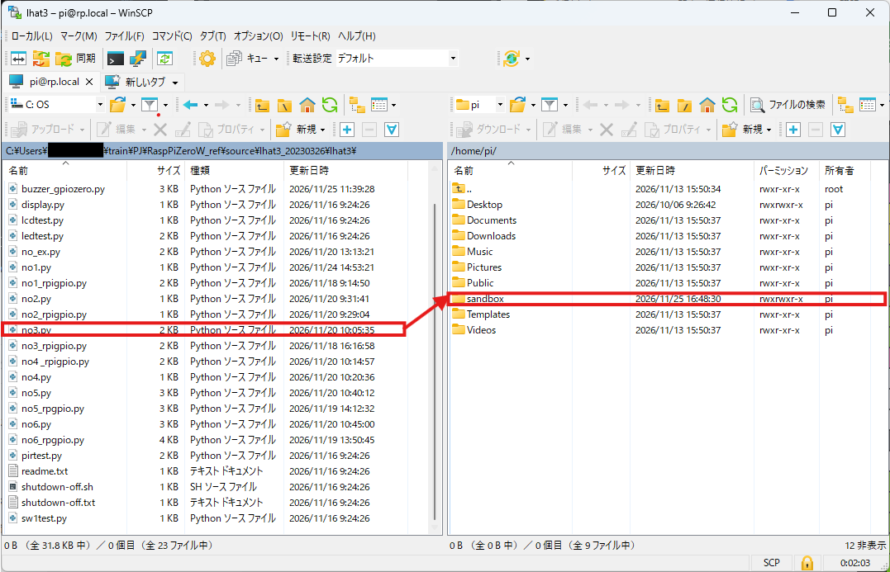
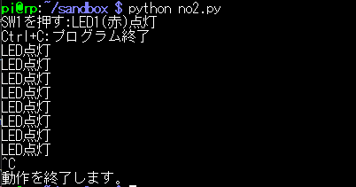
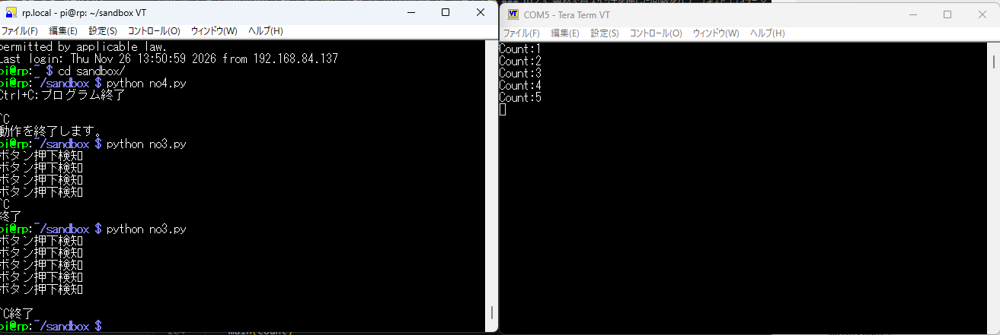
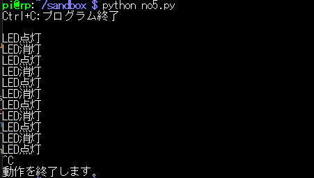
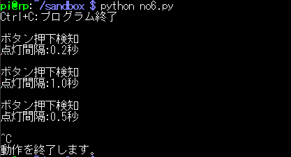

# ドラフト版

## 10.Python編【追加章】

### 10.0. はじめに なぜPythonを使うのか

この章では、Pythonを使用してこれまでの課題で与えられたことを再度実装することで、C言語とPythonの違いを体験してもらう。
Raspberry Pi OSにはあらかじめPythonがインストールされており、コンパイル(ビルド)を行わずに実行できるため、ハードウェア制御の動作検証を素早く実施できる。

### 10.1. 準備

ここでは、本課題を達成するのに必要なPythonの環境確認と外部ライブラリの導入を行う。

#### 10.1.1. Pythonと外部ライブラリの確認・インストール

前提条件として下記コマンドを実行し、想定しているバージョン`Python 3.13.x`が出力されていることを確認する。

```bash
python --version
```


> 確認: 上記実行結果のようにPython <バージョン> と表示されていれば、問題なし。

#### 外部ライブラリのインストール

**・gpiozero**:Raspberry Pi上のGPIO(I/Oポート)を制御する為に必要なライブラリ<br>
**・serial**:Pythonでシリアル通信を行うのに必要なライブラリ<br>

```bash
sudo apt install -y python3-gpiozero python3-serial
```


> 確認: 上記実行結果のようにエラーが表示されず、実行結果が表示されていれば、問題なし。

### 10.2.0 Pythonでの実装と実行

ここでは、第4,9章でC言語を使用して書かれたプログラムをPythonで書くことになっている。
お題は下記の通りとなっている。

- **題材1:** 赤LEDを0.5秒ごとに点滅
- **題材2:** 白スイッチを押している間だけ赤LEDを点灯
- **題材3:** 白スイッチを押した回数をパソコンに表示
- **題材4:** 一定の周期で赤LEDを点滅
- **題材5:** LEDとスイッチを別々のスレッドで動かす
- **題材6:** 白スイッチでLEDの点滅の速さを切り替える

C言語で作成したプログラム同様、Windows上でプログラムを作成し、SCP(WinSCP)を使用してRaspberry Pi上へ転送。 Raspberry Pi OS上でプログラムを実行する流れとなっている。

### 10.2.1. 題材1:赤LEDを0.5秒ごとに点滅

- **①作るもの:** 赤LEDを0.5秒間隔で点滅させる。
- **②配線:** LED1(赤) = BCM 17
- **③プログラム:** 使うライブラリ gpiozero

<details>
    <summary>no1.py</summary>

```py
# no1.py
import time
from gpiozero import LED

COUNT = 5                            # 繰り返し
r_led = LED(17)                      # LED1のBCM番号の指定

try:
   print("LED点灯テスト")
   for i in range(COUNT, 0, -1):
      remain = COUNT - i + 1
      print("点灯回数", remain)
      r_led.on()
      time.sleep(0.5)
      r_led.off()
      time.sleep(0.5)
finally:
   r_led.close()
```
</details>

- **④実行:**


WinSCP上でソースコードをRaspberry Pi上の任意のディレクトリに転送し、Raspberry Pi上のディレクトリで実行。

```bash
python no1.py
```

- **⑤動作確認:**


### 10.2.2. 題材2:白スイッチを押している間だけ赤LEDを点灯

- **①作るもの:** 白スイッチを押している間だけ赤LEDを点灯
- **②配線:** LED1(赤) = BCM 17, SW1(白スイッチ) = 24
- **③プログラム:** 使うライブラリ gpiozero

<details>
    <summary>no2.py</summary>

```py
# no2.py
# coding: UTF-8
from gpiozero import LED, Button
import time
import sys

# 出力ピン番号をBCMで指定する
LED1 = 17  # 赤のLED
SW1 = 24   # 白のタクトSW(SW1)
SLEEP_TIME = 0.05

# デバイスの初期化
led = LED(LED1)
button = Button(SW1, pull_up=False)

try:
    print("SW1を押す:LED1(赤)点灯\nCtrl+C:プログラム終了 ")
    while True:
        current_state = button.is_pressed
        if current_state:
            led.on()
            if not last_state:
                print("LED点灯")
        else:
            led.off()

        last_state = current_state
        time.sleep(SLEEP_TIME)

except KeyboardInterrupt:
    print("\n動作を終了します。")

finally:
    # クリーンアップして終了
    led.close()
    button.close()
    sys.exit()
```

</details>

- **④実行:** [題材1](#1021-題材1赤ledを05秒ごとに点滅)と同様にプログラムをRaspberry Pi上に転送し、Raspberry Pi上にて下記コマンドを実行する

```bash
python no2.py
```

- **⑤動作確認:**


> 確認: 白スイッチを押すとRaspberry Pi基盤上の赤LEDが点灯し、CLI上に"LED点灯"と出力されることを確認する。

### 10.2.3. 題材3:白スイッチを押した回数をパソコンに表示

- **①作るもの:** 白スイッチを押した回数をパソコンに表示する
- **②配線:** LED1(赤) = SW1(白スイッチ) = 24
- **③プログラム:** 使うライブラリ gpiozero

<details>
    <summary>no3.py</summary>

```py
# no3.py
import serial
from gpiozero import Button
import traceback
import time

SW1 = 24
MESSEAGE = "ボタン押下検知"
count = 0

button = Button(SW1, pull_up=False)

class UART:
    def __init__(self):
        try:
            self.uartport = serial.Serial('/dev/ttyS0', 115200, timeout=10)
        except serial.SerialException:
            print(traceback.format_exc())
            exit(1)
        
        self.uartport.reset_output_buffer()
        time.sleep(1)
    def send_serial(self, count):
        try:
            print(MESSEAGE)
            data = f"Count:{count}\n".encode("utf-8")
            self.uartport.write(data)            
        except serial.SerialException:
            print(traceback.format_exc())
    def close(self):
        if hasattr(self, "uartport") and self.uartport.is_open:
            self.uartport.close()

def main(count):
    uart = UART()
    try:
        while True:
            time.sleep(0.1)
            if button.is_pressed:
                count +=1
                uart.send_serial(count)
                while button.is_pressed:
                    time.sleep(0.05)
    except KeyboardInterrupt:
        print("\n終了")
    finally:
        button.close()
        uart.close()

if __name__ == '__main__':
    main(count)
```

</details>

- **④実行:** [題材1](#1021-題材1赤ledを05秒ごとに点滅)と同様にプログラムをRaspberry Pi上に転送し、Raspberry Pi上にて下記コマンドを実行する

```bash
python no3.py
```

- **⑤動作確認:**



> 確認: 白スイッチを押すと、CLI上に"ボタン押下検知"と出力されることを確認する。シリアル通信のCLI上に押下回数が出力されることを確認する。

### 10.2.4. 題材4:一定の周期で赤LEDを点滅

- **①作るもの:** 一定の周期で赤LEDを点滅
- **②配線:** LED1(赤) = 17
- **③プログラム:** 使うライブラリ gpiozero, pyserial

<details>
    <summary>no4.py</summary>

```py
# no4.py
# coding: UTF-8
import struct
from gpiozero import LED
import time
import sys
import os

# 出力ピン番号をBCMで指定する
LED1 = 17  # 赤のLED
SLEEP_TIME = 0.05
clock = time.CLOCK_MONOTONIC
sec_initial  = 0.5
sec_interval = 0.5
bite = 8

# デバイスの初期化
led = LED(LED1)

def main():
    fd = os.timerfd_create(clock)
    os.timerfd_settime(fd, initial=sec_initial, interval=sec_interval)
    led_state = False
    led.off()

    try:
        print("Ctrl+C:プログラム終了\n")
        while True:
            buf = os.read(fd, bite)
            total = struct.unpack("Q", buf)[0]

            if (0 != total):
                led_state = not led_state
                led.value = led_state
    except KeyboardInterrupt:
        print("\n動作を終了します。")
        led.close()
        sys.exit()

if __name__ == '__main__':
    main()
```

</details>

- **④実行:** [題材1](#1021-題材1赤ledを05秒ごとに点滅)と同様にプログラムをRaspberry Pi上に転送し、Raspberry Pi上にて下記コマンドを実行する

```bash
python no4.py
```

- **⑤動作確認:**


> 確認: 一定周期で赤LEDが点灯できていることを確認する。

### 10.2.5. 題材5:LEDとスイッチを別々のスレッドで動かす

- **①作るもの:** LEDとスイッチを別々のスレッドで動かす
- **②配線:** LED1(赤) = 17, スイッチ1(SW1) = 24
- **③プログラム:** 使うライブラリ gpiozero, pthread

<details>
    <summary>no5.py</summary>

```py
# no5.py
from gpiozero import LED, Button
import threading
import time
import sys

LED1 = 17                                                   # LED1のBCM番号の指定
SW1 = 24                                                    # 白のタクトSW(SW1)

led = LED(LED1)
button = Button(SW1, pull_up=False)

def sw_check(stop_event):
    last_state = False
    while not stop_event.is_set():
        current_state = button.is_pressed
        if current_state and not last_state :
            print("ボタン押下検知")
        last_state = current_state
        time.sleep(0.1)

def led_check(stop_event):
    led_state = False
    while not stop_event.is_set():
        led_state = not led_state
        led.value = led_state
        if True == led_state:
            print("LED点灯")
        else:
            print("LED消灯")
        stop_event.wait(timeout=0.5)
        
def main():
    stop_event = threading.Event()                         #イベント停止フラグ(初期値はFalse)を新規作成する
    thread1 = threading.Thread(target=sw_check,            #スレッド生成(スイッチ監視)
                               args=(stop_event,))
    thread2 = threading.Thread(target=led_check,           #スレッド生成(LED監視)
                               args=(stop_event,))
    
    try:
        print("Ctrl+C:プログラム終了\n")
        thread1.start()                                     #スレッド開始(スイッチ監視)
        thread2.start()                                     #スレッド開始(LED監視)
        while True:
            time.sleep(1)
    except KeyboardInterrupt:
        print("\n動作を終了します。")
        stop_event.set()
        thread1.join()                                      #スレッド停止(スイッチ監視)
        thread2.join()   
        led.close()                                   #スレッド停止(LED監視)
        button.close()
        sys.exit()

if __name__ == '__main__':
    main()
```

</details>

- **④実行:** [題材1](#1021-題材1赤ledを05秒ごとに点滅)と同様にプログラムをRaspberry Pi上に転送し、Raspberry Pi上にて下記コマンドを実行する

```bash
python no5.py
```

- **⑤動作確認:**



> 確認: 一定周期で赤LEDが点滅できていることを確認する。

### 10.2.6. 題材6:白スイッチでLEDの点滅の速さを切り替える

- **①作るもの:** 白スイッチでLEDの点滅の速さを切り替える
- **②配線:** LED1(赤) = 17, スイッチ1(SW1) = 24
- **③プログラム:** 使うライブラリ gpiozero, pthread

<details>
    <summary>no6.py</summary>

```py
from gpiozero import LED, Button
import threading
import queue
import time
import sys

LED1 = 17                                                   # LED1のBCM番号の指定
SW1 = 24                                                    # 白のタクトSW(SW1)
led = LED(LED1)
button = Button(SW1, pull_up=False)

interval = [0.5, 0.2, 1.0]

def sw_check(stop_event, cmd_queue):
    raw = 1
    last_state = False
    while not stop_event.is_set():
        current_state = button.is_pressed
        if current_state and not last_state :
            print(f"ボタン押下検知\n点灯間隔:{interval[raw]}秒\n")
            cmd_queue.put(interval[raw])                   #キューにプッシュ
            raw = (raw + 1) % len(interval)
        last_state = current_state
        time.sleep(0.1)
        

def led_check(stop_event, cmd_queue):
    led_state = False
    current_interval = interval[0]
    last_toggle = time.monotonic()
    while not stop_event.is_set():
        try:
            new_interval = cmd_queue.get(timeout=0.05)     #キューから取得する(0.05秒おきに現在の点灯間隔を取得する)
            current_interval = new_interval            
        except queue.Empty:
            pass
        
        if (current_interval <= time.monotonic() - last_toggle):
            led_state = not led_state
            led.value = led_state
            last_toggle = time.monotonic()
        
def main():
    stop_event = threading.Event()                         #イベント停止フラグ(初期値はFalse)を新規作成する
    cmd_queue  = queue.Queue()                             #スレッド間通信用のキューを生成
    thread1 = threading.Thread(target=sw_check,            #スレッド生成(スイッチ監視)
                               args=(stop_event, cmd_queue))
    thread2 = threading.Thread(target=led_check,           #スレッド生成(LED監視)
                               args=(stop_event, cmd_queue))
    
    try:
        print("Ctrl+C:プログラム終了\n")
        thread1.start()                                     #スレッド開始(スイッチ監視)
        thread2.start()                                     #スレッド開始(LED監視)
        while True:
            time.sleep(1)
    except KeyboardInterrupt:
        print("\n動作を終了します。")
    finally:
        stop_event.set()
        thread1.join()                                      #スレッド停止(スイッチ監視)
        thread2.join()                                      #スレッド停止(LED監視)
        led.close()                                   
        button.close()
        sys.exit()

if __name__ == '__main__':
    main()
```

</details>

- **④実行:** [題材1](#1021-題材1赤ledを05秒ごとに点滅)と同様にプログラムをRaspberry Pi上に転送し、Raspberry Pi上にて下記コマンドを実行する

```bash
python no6.py
```

- **⑤動作確認:**



> 確認: 白スイッチを押すとLEDの点灯間隔が変わることを確認する。
> CLI上に"ボタン押下検知 点灯間隔:x秒と"出力されることを確認する

### 10.3.0. 所感

Pythonはビルドを行わずに、そのまま実行できるのが利点。
Raspberry PiはOSにPythonが含まれているので、環境構築について気を遣う必要がない。

### 参考文献

Raspberry PiのセットアップからPython環境のインストールまで<br>
<https://qiita.com/nsuhara/items/05a2b41d94ced1f54316><br>
おまいらのthreading.Eventの使い方は間違っている<br>
<https://qiita.com/tag1216/items/2dcb112f8018eb19a999><br>
threading --- スレッドベースの並列処理<br>
<https://docs.python.org/ja/3/library/threading.html><br>
queue --- 同期キュークラス<br>
<https://docs.python.org/ja/3/library/queue.html><br>
