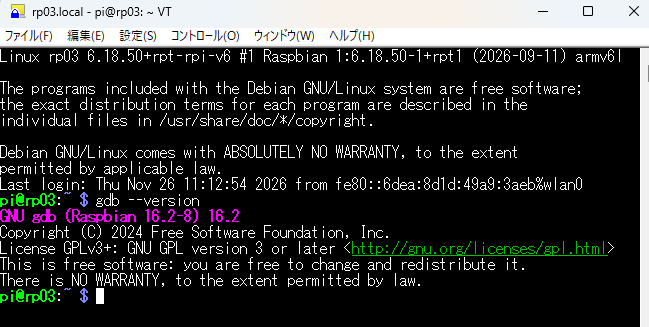

## 6. デバッグ

デバッグとは、プログラムに含まれる不具合（バグ）の原因を調査し、修正する作業である。

プログラムを実行しながら処理の流れや変数の値を確認することで、想定どおりに動作していない箇所を特定する。

本研修では、デバッガとしてGDBを使用する。

#### GDBとは

GDB（GNU Debugger）は、プログラムの実行状態を確認しながらデバッグを行うためのツールである。

ブレークポイントの設定、ステップ実行、変数やメモリの値の確認などをコマンドで操作できる。

GCCと同様にLinux環境で利用でき、コマンドラインから操作する。

IDEに搭載されたデバッガを使用できない環境でも利用できるため、本研修ではGDBを使用する。

### 6.1 デバッガの接続（配線図・写真）

GDBを使用するために、Raspberry Pi Zero WへのSSH接続と、デバッグ用プログラムのビルドを行う。

#### 1. SSH接続

パソコンからSSHを使用してRaspberry Pi Zero Wに接続する。

#### 2. GDBのインストール確認

1. 以下のコマンドを実行する。

   ```bash
   gdb --version
   ```

2. GDBのバージョン情報が表示されることを確認する。

   > 確認：GDBのバージョン情報が表示されれば成功。<br>
   

3. GDBがインストールされていない場合は、以下のコマンドでインストールする。

   ```bash
   sudo apt update
   sudo apt install gdb
   ```

#### 3. デバッグ対象のディレクトリへ移動

デバッグ対象のソースコードが保存されているディレクトリに移動する。

```bash
cd ディレクトリ名
```

#### 4. デバッグ用ビルド

1. コンパイル時にデバッグ情報を付加するため、`-g` オプションを指定してビルドする。

   ```bash
   gcc -g -o 実行ファイル名 ソースファイル名 -lgpiod
   ```

   pthreadを使用するプログラムの場合は、`-pthread` を追加する。

   ```bash
   gcc -g -pthread -o 実行ファイル名 ソースファイル名 -lgpiod
   ```

   ※ `-g` は、GDBでソースコードや変数の情報を確認するためのデバッグ情報を実行ファイルに付加するオプションである。

2. ビルド結果を確認する。

   > 確認：コンパイルエラーが発生せず、実行ファイルが作成されれば成功。<br>
   

### 6.2 デバッグの開始

GDBを起動し、デバッグ対象のプログラムを実行する。

#### 1. GDBの起動

1. 以下のコマンドを実行してGDBを起動する。

   ```bash
   gdb ./実行ファイル名
   ```

2. GDBのコマンド入力画面が表示されることを確認する。

   > 確認：`(gdb)` と表示されれば成功。

#### 2. プログラムの実行

1. 以下のコマンドを実行してプログラムを開始する。

   ```gdb
   run
   ```

2. プログラムが最後まで実行されることを確認する。

   > 確認：プログラムが正常に終了すれば成功。

#### 3. デバッグの終了

以下のコマンドを実行してGDBを終了する。

```gdb
quit
```

### 6.3 ブレークポイント・ステップ実行

ブレークポイントを設定してプログラムの実行を一時停止し、ステップ実行によって処理の流れを確認する。

#### 1. ブレークポイントの設定

ブレークポイントは、プログラムの実行を一時停止させる位置を指定する機能である。

1. 以下のコマンドを実行し、デバッグ対象のプログラムに含まれる関数を確認する。

   ```gdb
   info functions
   ```

2. 以下のコマンドを実行し、指定した関数の先頭にブレークポイントを設定する。

   ```gdb
   break 関数名
   ```

   例：`main`関数にブレークポイントを設定する場合

   ```gdb
   break main
   ```

3. ブレークポイントが設定されたことを確認する。

   ```gdb
   info breakpoints
   ```

   > 確認：指定した関数にブレークポイントが設定されていれば成功。

また、ファイル名と行番号を指定して設定することもできる。

```gdb
break ファイル名:行番号
```

例：

```gdb
break main.c:20
```

#### 2. プログラムの実行・停止

1. ブレークポイントを設定後、以下のコマンドを実行してプログラムを開始する。

   ```gdb
   run
   ```

2. プログラムがブレークポイントの位置で停止することを確認する。

   > 確認：設定した位置で実行が停止すれば成功。

#### 3. ステップ実行

プログラムがブレークポイントで停止した状態から、ソースコードを確認し、ステップ実行によって処理の流れを確認する。

##### ① ソースコードの確認

`list`コマンドを使用すると、デバッグ対象のソースコードを表示できる。

```gdb
list
```

行番号を指定して表示することもできる。

```gdb
list 行番号
```

例：

```gdb
list 20
```

##### ② ステップ実行

以下のコマンドを使用して、プログラムを1行ずつ実行する。

| コマンド | 内容 |
|---|---|
| `next`（`n`） | 次の行へ進む。関数呼び出しがあっても関数の中には入らない。 |
| `step`（`s`） | 次の行へ進む。関数呼び出しがある場合は関数の中に入る。 |
| `continue`（`c`） | 次のブレークポイントまで実行を再開する。 |

#### 4. ブレークポイントの削除

設定されているブレークポイントは、以下のコマンドで確認できる。

```gdb
info breakpoints
```

ブレークポイントを削除する場合は、以下のコマンドを実行する。

```gdb
delete ブレークポイント番号
```

例：

```gdb
delete 1
```

> 確認：指定したブレークポイントが削除されていれば成功。

### 6.4 変数・メモリ・レジスタの確認

プログラムの実行を一時停止した状態で、変数やメモリ、CPUのレジスタに格納されている値を確認する。

#### 1. 変数の確認

`print` コマンドを使用すると、指定した変数の値を確認できる。

```gdb
print 変数名
```

例：

```gdb
print count
```

また、`info locals` を使用すると、現在の関数内で使用されているローカル変数を確認できる。

```gdb
info locals
```

`display` コマンドを使用すると、ステップ実行のたびに指定した変数の値を自動的に表示できる。

```gdb
display 変数名
```

#### 2. メモリの確認

`x` コマンドを使用すると、指定したメモリアドレスに格納されているデータを確認できる。

```gdb
x/4xb アドレス
```

例：

```gdb
x/4xb &reg
```

変数 `reg` が格納されているメモリアドレスから4バイト分のデータを16進数で表示する。

変数のアドレスを指定する場合は、変数名の前に `&` を付ける。

| 指定 | 内容 |
|---|---|
| `4` | 表示するデータの個数 |
| `x` | 16進数で表示 |
| `b` | 1バイト単位で表示 |
| `&reg` | 変数 `reg` のメモリアドレス |

※ 変数名だけを指定すると、変数の値がメモリアドレスとして扱われる。そのため、変数自体が格納されているメモリを確認する場合は `&` を付ける。

#### 3. レジスタの確認

レジスタとは、CPU内部にある高速な記憶領域であり、演算やデータの受け渡しなどに使用される。

`info registers` コマンドを使用すると、CPUのレジスタに格納されている値を確認できる。

```gdb
info registers
```

> 確認：レジスタ名と格納されている値が表示されれば成功。

※ 表示されるレジスタの種類はCPUのアーキテクチャによって異なる。

