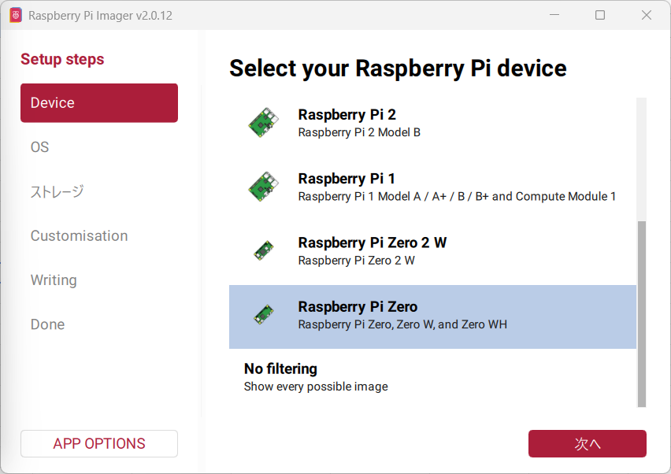
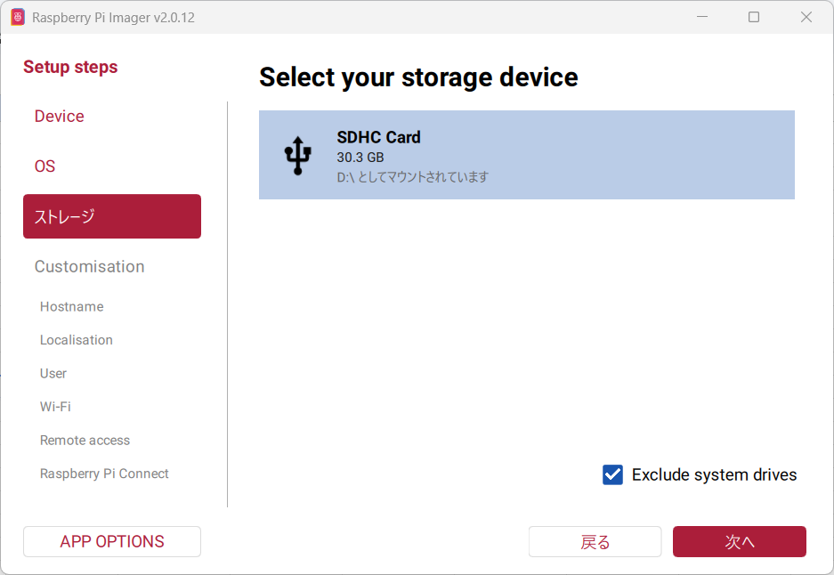
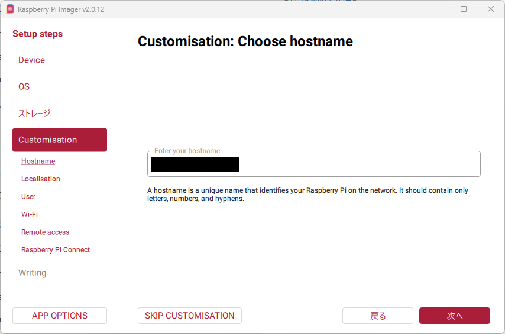
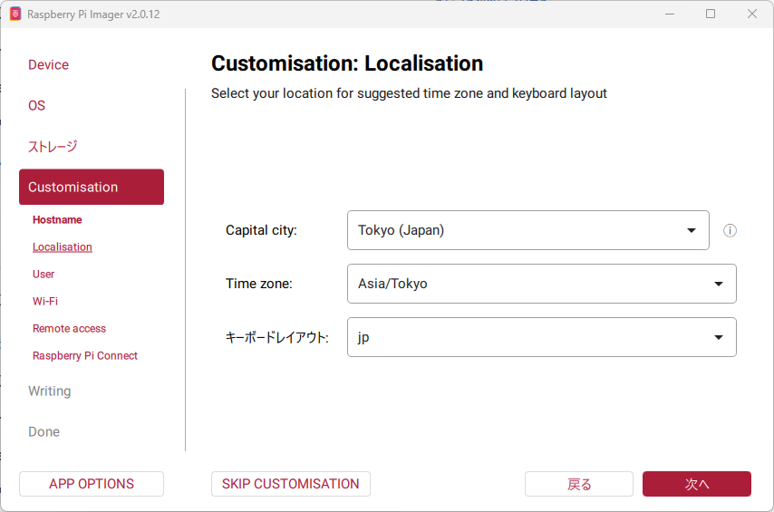
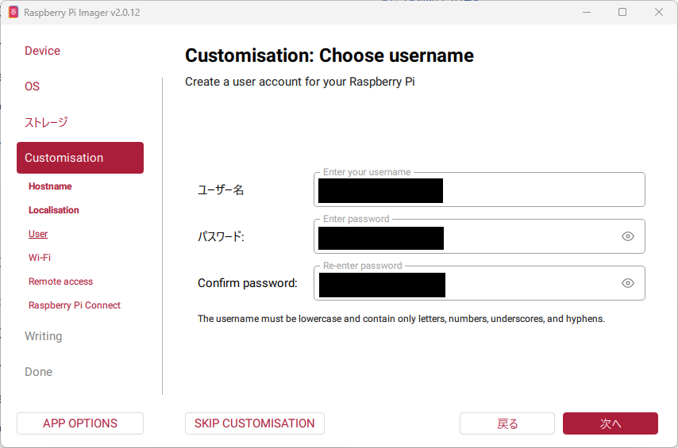
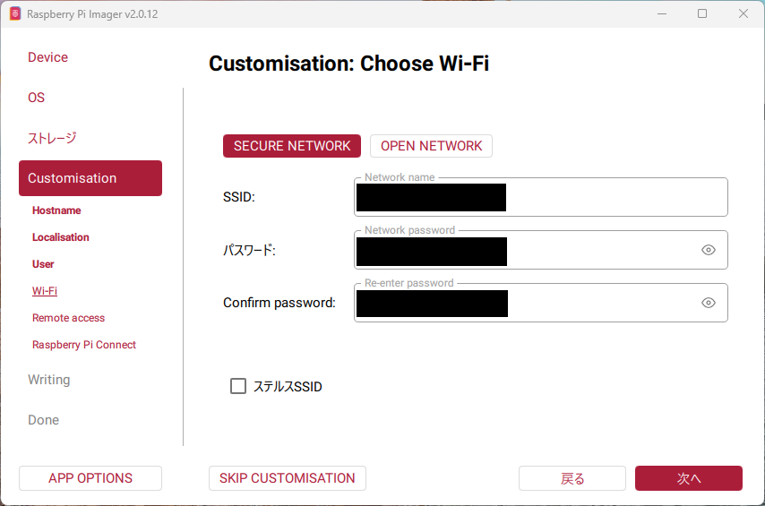
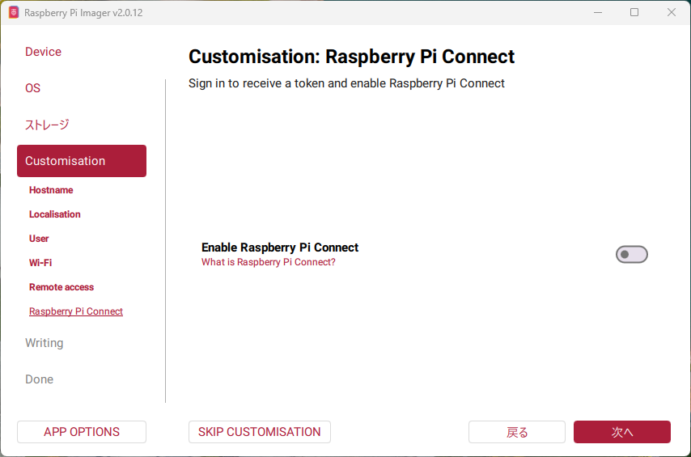
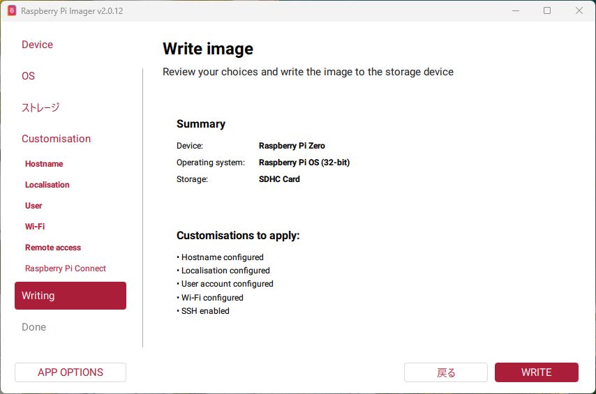
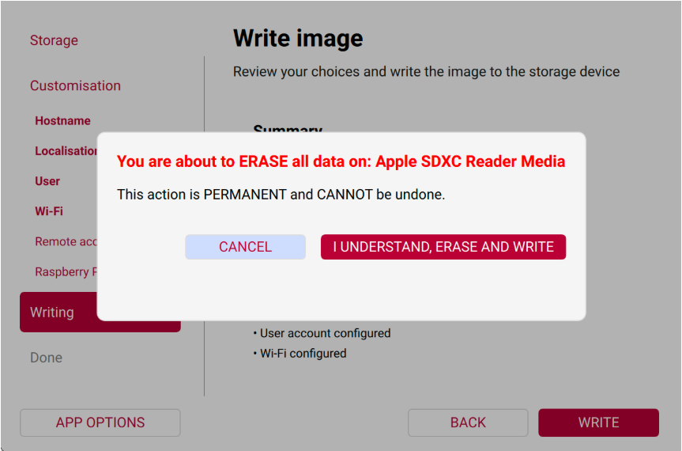
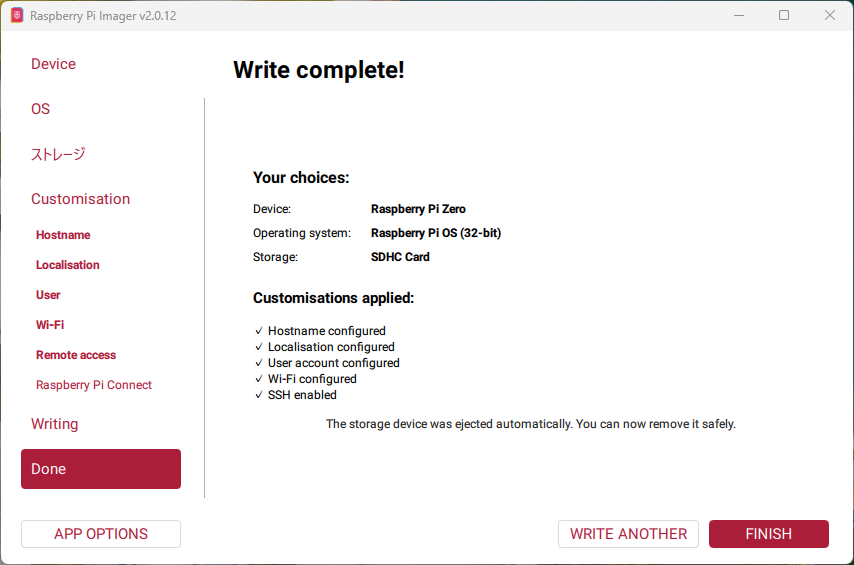

# 【Raspberry Pi Zero W】開発手順書

| 項目 | 内容 |
| ---- | ---- |
| 対象ボード | Raspberry Pi Zero W |
| 開発言語 | C / Python |
| IDE・ツール | TeraTerm 5.7.1 / Raspberry Pi Imager v2.0.12 / <br>OpenSSH_10 / GCC 14.2.0 / <br>GNU Make 4.4.1 / GDB 16.2 / <br>WinSCP-6.5.5 |
| SDK・ライブラリ | libgpiod 2.2.1 |
| 開発PCのOS | Windows 11 26H2 |
| 最終検証日 | 2026/11/24 |

## 改版履歴

| 版 | 日付 | 担当者 | 内容 |
|---|---|---|---|
| 0.1 | (yyyy/mm/dd) | | 新規作成 |

---

## 0. 概要

本手順書では、Raspberry Pi Zero Wを使用した開発環境の構築から、プログラムの作成・ビルド・実行、デバッグまでの手順を説明する。

Raspberry Pi Zero Wでは、Linuxを搭載した Raspberry Pi OS 上でプログラムを実行する。PCからSSHやシリアル通信を利用して操作し、GPIOなどの機能を使用した開発を行う。

### 0.1 この手順書でできること

本手順書に沿って作業することで、Raspberry Pi Zero Wを使用した基本的なプログラム開発ができるようになることを目的とする。

具体的には、以下の内容を学習する。

- Raspberry Pi OSの導入と開発環境の構築
- PCからRaspberry Pi Zero WへのSSH接続
- シリアルターミナルを使用した通信とログの確認
- プロジェクトの作成
- C言語・Pythonによるプログラムの作成、ビルド、実行
- GPIOを使用したLEDやスイッチの制御
- UARTを使用したシリアル通信
- GDBを使用したプログラムのデバッグ
- pthreadを使用したマルチスレッド処理

### 0.2 必要な機材

| 品名 | 数量 | 備考 |
|---|---|---|
| Raspberry Pi Zero W | 1台 | 開発対象のボード |
| IoT学習HATキット | 1個 | LED・スイッチなどの制御に使用 |
| microSDカード（16GB以上） | 1枚 | OSとプログラムの保存に使用 |
| USBケーブル（micro-B）と電源 | 1式 | Raspberry Pi Zero Wへの給電に使用 |
| CH340E USBシリアル変換モジュール | 必要な数 | PCとRaspberry Pi Zero W間のシリアル通信に使用 |
| ジャンパワイヤ（メス-メス） | 2本 | Raspberry Pi Zero WとCH340Eの接続に使用 |
| USBケーブル（Type-C） | 1本 | CH340EとPCの接続に使用 |

### 0.3 前提知識・事前準備

本手順書を進めるにあたり、以下の知識と準備を必要とする。

#### 前提知識

| 項目 | 説明 |
|---|---|
| Windowsの基本操作 | アプリケーションの起動、ファイル操作、デバイスマネージャーの確認など |
| コマンド操作 | Linuxのターミナルでコマンドを入力する基本操作 |
| C言語の基礎 | 変数、条件分岐、繰り返し、関数などの基本的な文法 |
| Pythonの基礎 | 変数、条件分岐、繰り返し、関数などの基本的な文法 |

#### 用語の説明

| 用語 | 説明 |
|---|---|
| Raspberry Pi OS | Raspberry Piで動作するLinuxベースのOS |
| microSDカード | OSやプログラムなどのデータを保存する記憶媒体 |
| SSH | ネットワークを経由して、別のコンピュータに接続し、コマンド操作を行うための通信方式 |
| GPIO | LEDやスイッチなどの外部機器と信号の入出力を行うための端子 |
| UART | 送信線と受信線を使用して、データを1ビットずつ順番に送受信するシリアル通信方式 |

#### 事前準備

- 開発用PCを用意する。
- Raspberry Pi Zero Wと必要な周辺機器を用意する。
- Raspberry Pi Zero Wを接続するWi-FiのSSIDとパスワードを確認する。
- PCにソフトウェアをインストールできる環境を用意する。

#### シリアル通信の通信条件

本手順書では、UARTによるシリアル通信に以下の通信条件を使用する。

| 通信条件 | 設定値 | 説明 |
|---|---|---|
| ボーレート | 115200 bps | 1秒間に送信するビット数を表す |
| データ長 | 8 bit | 1回のデータ送信で使用するデータビット数を表す |
| パリティ | None | パリティビットによる誤り検出を行わない設定 |
| ストップビット | 1 bit | 1回のデータ送信の終了を示すビット数を表す |
| フロー制御 | None | 送受信のタイミングを制御する仕組みを使用しない設定 |
## 1. 開発環境構築

本章では、Raspberry Pi Zero W で C 言語のプログラムを開発するために必要なツールとドライバを準備する。

### 1.1 ツールのインストール

本手順では、開発PCから Raspberry Pi Zero W を操作し、Raspberry Pi 上でプログラムのビルドやデバッグを行うためのツールを使用する。

#### 1.1.1 Raspberry Pi Imager のインストール

本節では、Raspberry Pi Zero W に OS を書き込むために使用する Raspberry Pi Imager のインストール手順を記載する。

1. 下記のリンクより、Raspberry Pi 公式ソフトウェアページにアクセスする。

[Raspberry Pi 公式ソフトウェアページ](https://www.raspberrypi.com/software/)

2. Windows 用の Raspberry Pi Imager をダウンロードする。


3. ダウンロードしたインストーラーをダブルクリックする。

4. ユーザーアカウント制御の画面が表示された場合は、内容を確認してインストールを許可する。

5. インストール画面が表示されたら、画面の指示に従ってインストールする。


6. インストール完了後、スタートメニューから Raspberry Pi Imager を起動する。


> 確認：Raspberry Pi Imager のメイン画面が表示されればインストール成功。

> 注意：Raspberry Pi Imager で設定したホスト名・ユーザー名・パスワードは、後で SSH 接続するときに使用するため、忘れないように控えておくこと。

#### 1.1.2 Raspberry Pi OS の書き込み・初期設定
1. Raspberry Pi Zero WのマイクロSDをPCに挿入する
2. Raspberry Pi Imagerを起動する
3. Deviceを設定する<br>
Raspberry Pi Zeroを選択し、次へを押下する。<br>

4. OSを設定する<br>
Raspberry Pi OS (32-bit)を選択し、次へを押下する。<br>

5. ストレージを設定する<br>
表示されているストレージデバイスから選択し、次へを押下する。<br>
**※ Exclude system drivesのチェックはつけておく。**<br>

6. hostnameを設定する<br>
文字、数字、ハイフンのみで入力し、次へを押下する。<br>

7. Localisationを設定する<br>

8. usernameを設定する<br>
小文字で、文字、数字、アンダースコア、ハイフンのみで入力、パスワードも入力を行い、次へを押下する。<br>

9. Wi-Fiを設定する<br>

10. SSH authenticationを設定する<br>

11. Raspberry Pi Connectを設定する<br>

12. Writeを押下し、書き込みを始める<br>

13. I UNDERSTAND, ERASE AND WRITEを押下する<br>
書き込み時に、現在マイクロSDに書かれている内容を削除してから書き込むことを確認されているため、理解していることを伝える。<br>

14. 書き込みが終了したらFINISHを押下する<br>

15. マイクロSDカードを抜く

#### 1.1.3 TeraTermのインストール
本節では、PC とマイコンをシリアル通信で接続し、データの送受信や確認をするために使用する TeraTerm のインストール手順を記載する。
1. 下記のリンクより、 TerTerm 公式 GitHub にアクセスする。  
[TerTerm 公式 GitHub](https://github.com/TeraTermProject/teraterm/releases)
1. TeraTerm 5.7.1の Assets から **teraterm-5.7.1-x64.exe** をダウンロードする。  
  
1. ダウンロードした**teraterm-5.7.1-x64.exe** をダブルクリックする。
  
1. 「インストールモードの選択」画面が開かれ、**現在のユーザー用にインストール(M)(推奨)** を押下する。  
  
1. 「セットアップに使用する言語の選択」画面が開かれ、インストール中に利用する言語を**日本語**を選択する。
  
1. 「使用許諾契約書の同意」画面が開かれ、同意する(A)を押下する。  
  
1. 次へ(N)を押下する。  
    
1. 「インストール先の指定」画面が開かれ、次へ(N)を押下する。  
  
1. 「コンポーネントの選択」画面が開かれ、次へ(N)を押下する。  
  
1. 「言語の選択」画面が開かれ、日本語(J)を押下する。  
  
1. 「スタートメニューフォルダーの指定」画面が開かれ、次へ(N)を押下する。  
  
1. 「追加タスクの選択」画面が開かれ、次へ(N)を押下する。  
  
1. 「インストールの準備完了」画面が開かれ、インストール(I)を押下する。  
  
    >確認：TeraTerm セットアップウィザードの完了が表示されればインストール成功  
      

#### 1.1.4 Windows OpenSSH の確認

Windows OpenSSH は、開発PCから Raspberry Pi Zero W に SSH 接続したり、ファイルを転送したりするために使用する。

1. コマンドプロンプトを起動する。
2. 以下のコマンドを実行する。

```cmd
ssh -V
```

3. OpenSSH のバージョンが表示されることを確認する。

> 確認：OpenSSH のバージョンが表示されれば成功。

#### 1.1.5 Raspberry Pi 側の開発ツールの準備

Raspberry Pi 上で C 言語のプログラムをビルド・デバッグするため、以下のツールを使用する。

| ツール | 用途 |
|---|---|
| GCC | C 言語のコンパイル |
| GNU Make | ビルド作業の自動化 |
| GDB | プログラムのデバッグ |
| libgpiod | GPIO の操作 |

1. TeraTerm を起動する。
2. Raspberry Pi Zero W に SSH 接続する。
3. パッケージ情報を更新する。

```bash
sudo apt update
```

4. 必要な開発ツールをインストールする。

```bash
sudo apt install -y build-essential
```

> 確認：インストールが完了し、エラーが表示されなければ成功。

#### 1.1.6 WinSCP のインストール

本節では、開発 PC と Raspberry Pi Zero W の間でファイルを転送するために使用する WinSCP のインストール手順を記載する。

1. エクスプローラーを起動する。

2. アドレスバーに以下のパスを入力し、研修環境の共有フォルダにアクセスする。

   ```text
   Y:\Application\
   ```
> 注意：wi-fiはhip-systrainに接続していること。

3. `WinSCP-6.5.5-Setup.exe` を選択する。

4. インストーラーを開発 PC のローカルフォルダにコピーする。

   例：ダウンロードフォルダ

5. コピーした `WinSCP-6.5.5-Setup.exe` をダブルクリックする。

6. インストール画面が表示されたら、画面の指示に従ってインストールする。
> 確認：インターフェーススタイルはコマンダーを選択すること。

7. インストール完了後、スタートメニューから WinSCP を起動する。

> 確認：WinSCP のログイン画面が表示されればインストール成功。

> 注意：研修環境の共有フォルダにあるインストーラーは、直接実行せず、開発 PC のローカルフォルダにコピーしてから使用すること。

> 注意：WinSCP で Raspberry Pi Zero W に接続する際は、SSH 接続に使用するホスト名、IP アドレス、ユーザー名、パスワードを使用すること。

### 1.2 ドライバのインストール

本手順では、CH340E USB シリアル変換モジュールを開発PCで認識させるためのドライバを準備する。

1. CH340E USB シリアル変換モジュールを開発PCに接続する。
2. Windows のデバイスマネージャーを起動する。
3. 「ポート（COM と LPT）」に接続した機器が表示されるか確認する。
4. 機器が認識されない場合は、CH340E 用ドライバを入手する。
5. ダウンロードしたドライバのインストーラーを実行する。
6. 画面の指示に従ってインストールする。
7. 必要に応じて USB シリアル変換モジュールを接続し直す。

> 確認：「ポート（COM と LPT）」に USB-SERIAL CH340 などの機器が表示されれば成功。

> 注意：ドライバの名称や表示内容は、ドライバのバージョンによって異なる場合がある。

### 1.3 インストールできたことの確認

インストールしたツールが使用できることを確認する。

#### 1.3.1 開発PC側の確認

1. コマンドプロンプトを起動する。
2. 以下のコマンドを実行する。

```cmd
ssh -V
```

3. OpenSSH のバージョンが表示されることを確認する。
4. TeraTerm を起動できることを確認する。
5. デバイスマネージャーで CH340E が認識されていることを確認する。

> 確認：各ツールが起動でき、CH340E が認識されていれば成功。

#### 1.3.2 Raspberry Pi 側の確認

1. TeraTerm を起動する。
2. Raspberry Pi Zero W に SSH 接続する。
3. GCC のバージョンを確認する。

```bash
gcc --version
```

4. GNU Make のバージョンを確認する。

```bash
make --version
```

5. GDB のバージョンを確認する。

```bash
gdb --version
```

6. libgpiod のバージョンを確認する。

```bash
pkg-config --modversion libgpiod
```

> 確認：各ツールのバージョンが表示されれば成功。

## 2. シリアルターミナルの使い方

本章では、CH340E USB シリアル変換モジュールを使用して、開発PCと Raspberry Pi Zero W をシリアル通信で接続し、TeraTerm から操作する方法を説明する。

### 2.1 使用するツールと接続方法

本手順では、TeraTerm と CH340E USB シリアル変換モジュールを使用して、Raspberry Pi Zero W と開発PCを接続する。

#### 2.1.1 使用するツール

| ツール | 用途 |
|---|---|
| TeraTerm | シリアル通信によるコマンド入力・出力確認 |
| CH340E USB シリアル変換モジュール | PCとRaspberry Pi間のシリアル通信 |
| USBケーブル | CH340Eと開発PCの接続 |
| ジャンパーワイヤー | CH340EとRaspberry Piの接続 |

#### 2.1.2 Raspberry Pi と CH340E の接続

1. Raspberry Pi Zero W の電源が OFF になっていることを確認する。
2. CH340E USB シリアル変換モジュールと Raspberry Pi Zero W の GPIO ピンをジャンパーワイヤーで接続する。

| CH340E側 | Raspberry Pi Zero W側 | 物理ピン番号 | 
| -------- | --------------------- | ------------ | 
| TXD      | GPIO15（RXD）         | 10           | 
| RXD      | GPIO14（TXD）         | 8            | 
| GND      | GND                   | 6            | 

<!--※Raspberry Pi Zero W へのログインに必要なためTXDも接続する-->


3. CH340E USB シリアル変換モジュールを USB ケーブルで開発PCに接続する。
4. Raspberry Pi Zero W の電源を ON にする。

> 確認：CH340E が開発PCに接続され、Raspberry Pi Zero W の電源が ON になっていれば成功。

> 注意：CH340E の信号は 5V、Raspberry Pi Zero W は 3.3V。CH340E の TXD を Raspberry Pi Zero W につなぐと、Raspberry Pi Zero W が壊れるおそれがある。

#### 2.1.3 TeraTerm の起動と接続

1. TeraTerm を起動する。
2. 「新しい接続」画面で「シリアル」を選択する。
3. 接続先として CH340E に割り当てられた COM ポートを選択する。
4. 「OK」を押下する。


> 確認：TeraTerm の画面が開き、選択した COM ポートに接続できれば成功。

### 2.2 通信設定

Raspberry Pi Zero W とシリアル通信を行うため、TeraTerm の通信設定を行う。

1. TeraTerm のメニューから「設定」→「シリアルポート」を選択する。
2. 以下の通信設定を行う。

| 設定項目 | 設定値 |
|---|---|
| ポート | CH340E に割り当てられた COM ポート |
| スピード | 115200 |
| データ | 8 bit |
| パリティ | none |
| ストップビット | 1 bit |
| フロー制御 | none |


3. 設定内容を確認して「OK」を押下する。

> 確認：各通信設定が表の値と一致していれば成功。

### 2.3 動作確認

シリアル通信によって Raspberry Pi Zero W の起動メッセージが表示されることを確認する。

1. Raspberry Pi Zero W の電源を OFF にする。
```bash
sudo shutdown -h now
```
2. TeraTerm がシリアルポートに接続されていることを確認する。
3. Raspberry Pi Zero W の電源を ON にする。
4. TeraTerm の画面に起動メッセージが表示されることを確認する。
5. ログインを求められた場合は、Raspberry Pi Imager で設定したユーザー名とパスワードを入力する。

> 確認：Raspberry Pi Zero W の起動メッセージが表示され、ログイン後にコマンドを入力できれば成功。

> 注意：パスワード入力中は、入力した文字が画面に表示されない。
