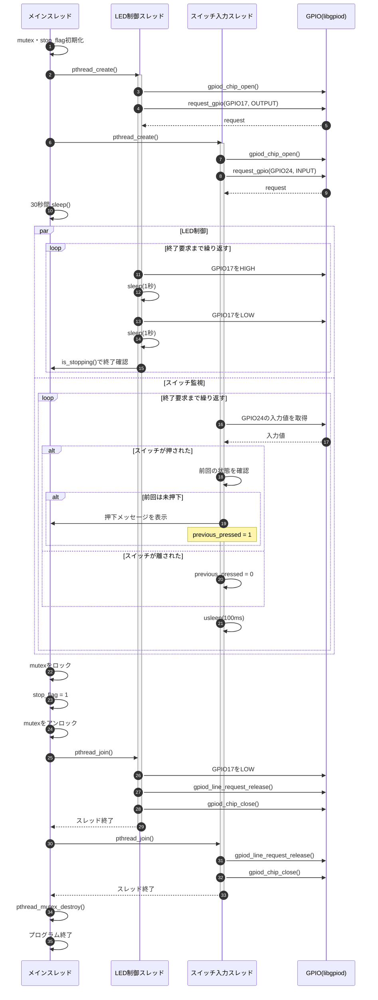
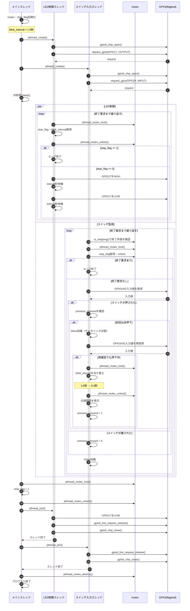

<!--
  手順書テンプレート(全ボード共通)
  - このファイルをコピーして、ボードごとのフォルダに保存してから書き始める。
  - 章の番号と名前は変えない。該当しない章は消さずに「本ボードでは作成しない(理由:〜)」と書く。
  - ボード独自の内容は、第9章以降に追加章として書く。
  - このコメントはプレビューには表示されない。消さずに残してよい。
-->

# 【ボード名】開発手順書

| 項目 | 内容 |
|---|---|
| 対象ボード | |
| 開発言語 | |
| IDE・ツール | (名称とバージョン) |
| SDK・ライブラリ | (名称とバージョン) |
| 開発PCのOS | (例:Windows 11 24H2) |
| 最終検証日 | (yyyy/mm/dd) |

## 改版履歴

| 版 | 日付 | 担当者 | 内容 |
|---|---|---|---|
| 0.1 | (yyyy/mm/dd) | | 新規作成 |

---

## 0. 概要

### 0.1 この手順書でできること
<!-- 読者がこの手順書を最後まで進めると何ができるようになるかを書く -->

### 0.2 必要な機材

| 品名 | 数量 | 備考 |
|---|---|---|
| | | |

### 0.3 前提知識・事前準備
<!-- 既存の Git/GitHub 運用・Redmine 運用を参考に、前提とする知識と準備を書く -->

---

## 1. 開発環境構築

### 1.1 ツールのインストール
### 1.2 ドライバのインストール
### 1.3 インストールできたことの確認

## 2. シリアルターミナルの使い方

### 2.1 使用するツールと接続方法
### 2.2 通信設定(ポート、ボーレートなど)
### 2.3 動作確認

## 3. プロジェクト作成

### 3.1 新規プロジェクトの作成
### 3.2 プロジェクトの構成(フォルダ・ファイルの役割)

## 4. コーディング・ビルド・書込み(RTOSなし)

<!-- 各題材の節は「作るもの → 配線 → プログラム → ビルドと書込み → 動作確認」の順で書く -->

### 4.1 題材1:LED点滅
### 4.2 題材2:ボタン入力
### 4.3 題材3:UART出力
### 4.4 題材4:タイマ割込み

## 5. コーディング・ビルド・書込み（FreeRTOS）

本手順書で使用するRaspberry Pi Zero Wは、Linuxが動作するボードである。

そのため、リアルタイムOSであるFreeRTOSの導入・設定は行わない。

また、FreeRTOSを使用した複数タスクの実行やタスク間通信についても、本手順書では実施しない。

なお、複数の処理を並行して実行する方法については、Linuxのpthreadを使用し、第9章「マルチスレッド（pthread）」で説明する。

### 5.1 FreeRTOSの導入・設定

Raspberry Pi Zero WではLinuxを使用するため、FreeRTOSの導入・設定は実施しない。

### 5.2 題材5：複数タスク

FreeRTOSを使用しないため、複数タスクの作成・実行は実施しない。

複数の処理を並行して実行する方法については、第9章「マルチスレッド（pthread）」で説明する。

### 5.3 題材6：タスク間通信

FreeRTOSを使用しないため、FreeRTOSによるタスク間通信は実施しない。

pthreadを使用したスレッド間のデータ共有と排他制御については、第9章「マルチスレッド（pthread）」で説明する。

## 6. デバッグ

デバッグとは、プログラムに含まれる不具合（バグ）の原因を調査し、修正する作業である。

プログラムを実行しながら処理の流れや変数の値を確認することで、想定どおりに動作していない箇所を特定する。

本研修では、デバッガとしてGDBを使用する。

#### GDBとは

GDB（GNU Debugger）は、プログラムの実行状態を確認しながらデバッグを行うためのツールである。

ブレークポイントの設定、ステップ実行、変数やメモリの値の確認などをコマンドで操作できる。

GCCと同様にLinux環境で利用でき、コマンドラインから操作する。

IDEに搭載されたデバッガを使用できない環境でも利用できるため、本研修ではGDBを使用する。

### 6.1 デバッガの接続（配線図・写真）

GDBを使用するために、Raspberry Pi Zero WへのSSH接続と、デバッグ用プログラムのビルドを行う。

#### 1. SSH接続

パソコンからSSHを使用してRaspberry Pi Zero Wに接続する。

#### 2. GDBのインストール確認

1. 以下のコマンドを実行する。

   ```bash
   gdb --version
   ```

2. GDBのバージョン情報が表示されることを確認する。

   > 確認：GDBのバージョン情報が表示されれば成功。

3. GDBがインストールされていない場合は、以下のコマンドでインストールする。

   ```bash
   sudo apt update
   sudo apt install gdb
   ```

#### 3. デバッグ対象のディレクトリへ移動

デバッグ対象のソースコードが保存されているディレクトリに移動する。

```bash
cd ディレクトリ名
```

#### 4. デバッグ用ビルド

1. コンパイル時にデバッグ情報を付加するため、`-g` オプションを指定してビルドする。

   ```bash
   gcc -g -o 実行ファイル名 ソースファイル名 -lgpiod
   ```

   pthreadを使用するプログラムの場合は、`-pthread` を追加する。

   ```bash
   gcc -g -pthread -o 実行ファイル名 ソースファイル名 -lgpiod
   ```

   ※ `-g` は、GDBでソースコードや変数の情報を確認するためのデバッグ情報を実行ファイルに付加するオプションである。

2. ビルド結果を確認する。

   > 確認：コンパイルエラーが発生せず、実行ファイルが作成されれば成功。

### 6.2 デバッグの開始

GDBを起動し、デバッグ対象のプログラムを実行する。

#### 1. GDBの起動

1. 以下のコマンドを実行してGDBを起動する。

   ```bash
   gdb ./実行ファイル名
   ```

2. GDBのコマンド入力画面が表示されることを確認する。

   > 確認：`(gdb)` と表示されれば成功。

#### 2. プログラムの実行

1. 以下のコマンドを実行してプログラムを開始する。

   ```gdb
   run
   ```

2. プログラムが最後まで実行されることを確認する。

   > 確認：プログラムが正常に終了すれば成功。

#### 3. デバッグの終了

以下のコマンドを実行してGDBを終了する。

```gdb
quit
```

### 6.3 ブレークポイント・ステップ実行

ブレークポイントを設定してプログラムの実行を一時停止し、ステップ実行によって処理の流れを確認する。

#### 1. ブレークポイントの設定

ブレークポイントは、プログラムの実行を一時停止させる位置を指定する機能である。

1. 以下のコマンドを実行し、デバッグ対象のプログラムに含まれる関数を確認する。

   ```gdb
   info functions
   ```

2. 以下のコマンドを実行し、指定した関数の先頭にブレークポイントを設定する。

   ```gdb
   break 関数名
   ```

   例：`main`関数にブレークポイントを設定する場合

   ```gdb
   break main
   ```

3. ブレークポイントが設定されたことを確認する。

   ```gdb
   info breakpoints
   ```

   > 確認：指定した関数にブレークポイントが設定されていれば成功。

また、ファイル名と行番号を指定して設定することもできる。

```gdb
break ファイル名:行番号
```

例：

```gdb
break main.c:20
```

#### 2. プログラムの実行・停止

1. ブレークポイントを設定後、以下のコマンドを実行してプログラムを開始する。

   ```gdb
   run
   ```

2. プログラムがブレークポイントの位置で停止することを確認する。

   > 確認：設定した位置で実行が停止すれば成功。

#### 3. ステップ実行

プログラムがブレークポイントで停止した状態から、ソースコードを確認し、ステップ実行によって処理の流れを確認する。

##### ① ソースコードの確認

`list`コマンドを使用すると、デバッグ対象のソースコードを表示できる。

```gdb
list
```

行番号を指定して表示することもできる。

```gdb
list 行番号
```

例：

```gdb
list 20
```

##### ② ステップ実行

以下のコマンドを使用して、プログラムを1行ずつ実行する。

| コマンド | 内容 |
|---|---|
| `next`（`n`） | 次の行へ進む。関数呼び出しがあっても関数の中には入らない。 |
| `step`（`s`） | 次の行へ進む。関数呼び出しがある場合は関数の中に入る。 |
| `continue`（`c`） | 次のブレークポイントまで実行を再開する。 |

#### 4. ブレークポイントの削除

設定されているブレークポイントは、以下のコマンドで確認できる。

```gdb
info breakpoints
```

ブレークポイントを削除する場合は、以下のコマンドを実行する。

```gdb
delete ブレークポイント番号
```

例：

```gdb
delete 1
```

> 確認：指定したブレークポイントが削除されていれば成功。

### 6.4 変数・メモリ・レジスタの確認

プログラムの実行を一時停止した状態で、変数やメモリ、CPUのレジスタに格納されている値を確認する。

#### 1. 変数の確認

`print` コマンドを使用すると、指定した変数の値を確認できる。

```gdb
print 変数名
```

例：

```gdb
print count
```

また、`info locals` を使用すると、現在の関数内で使用されているローカル変数を確認できる。

```gdb
info locals
```

`display` コマンドを使用すると、ステップ実行のたびに指定した変数の値を自動的に表示できる。

```gdb
display 変数名
```

#### 2. メモリの確認

`x` コマンドを使用すると、指定したメモリアドレスに格納されているデータを確認できる。

```gdb
x/4xb アドレス
```

例：

```gdb
x/4xb &reg
```

変数 `reg` が格納されているメモリアドレスから4バイト分のデータを16進数で表示する。

変数のアドレスを指定する場合は、変数名の前に `&` を付ける。

| 指定 | 内容 |
|---|---|
| `4` | 表示するデータの個数 |
| `x` | 16進数で表示 |
| `b` | 1バイト単位で表示 |
| `&reg` | 変数 `reg` のメモリアドレス |

※ 変数名だけを指定すると、変数の値がメモリアドレスとして扱われる。そのため、変数自体が格納されているメモリを確認する場合は `&` を付ける。

#### 3. レジスタの確認

レジスタとは、CPU内部にある高速な記憶領域であり、演算やデータの受け渡しなどに使用される。

`info registers` コマンドを使用すると、CPUのレジスタに格納されている値を確認できる。

```gdb
info registers
```

> 確認：レジスタ名と格納されている値が表示されれば成功。

※ 表示されるレジスタの種類はCPUのアーキテクチャによって異なる。

## 7. トラブルシューティング

| 症状 | 原因 | 対処 |
|---|---|---|
| | | |

## 8. 参考資料
- GDBマニュアルの和訳(https://www.asahi-net.or.jp/~wg5k-ickw/html/online/gdb-5.0/gdb-ja_toc.html)
- pthreads(7) — POSIXスレッドの概要(https://man7.org/linux/man-pages/man7/pthreads.7.html?utm_source=chatgpt.com)

## 9. マルチスレッド(pthread)
本章では、pthreadを使用したマルチスレッド処理について説明する。

pthreadの基本的な仕組みや関数の使い方を確認し、複数のスレッドで処理を実行するプログラムを作成する。

また、スレッド間でのデータ共有や排他制御、GDBを使用したデバッグ方法について学習する。

### 9.1 pthreadとは

pthread（POSIX Threads）とは、LinuxなどのOSで
マルチスレッド処理を実現するための仕組みである。

#### プロセスとスレッドの違い

プロセスとは、実行中のプログラムと、その実行に必要な
メモリなどの資源を管理する単位である。

スレッドとは、プロセス内で処理を実行する単位である。
1つのプロセス内に複数のスレッドを作成することで、
複数の処理を並行して実行できる。

同じプロセス内のスレッドはメモリなどの資源を共有するため、
スレッド間でデータを共有できる。

#### Raspberry Pi Zero Wでpthreadを使用する理由

Raspberry Pi Zero WではLinuxが動作している。
Linuxはマルチスレッド処理に対応しており、
C言語からpthreadを使用してスレッドを作成・管理できる。

本手順書では、FreeRTOSを使用せず、
Linuxのpthreadを利用して複数の処理を並行して実行する。

### 9.2 pthreadを使用するプログラムの作成

pthreadを使用すると、1つのプログラム内で複数のスレッドを作成し、それぞれのスレッドで処理を実行できる。

ここでは、pthreadを使用するための基本的な関数と、プログラムの作成・コンパイル方法を説明する。

#### pthreadの基本的な関数

pthreadでは、主に次の関数を使用する。

| 関数 | 役割 |
| ---- | ---- |
| `pthread_create()` | 新しいスレッドを作成し、処理を開始する |
| `pthread_join()` | 指定したスレッドの終了を待つ |
| `pthread_mutex_lock()` | 排他制御を開始し、共有データへのアクセスを制限する |
| `pthread_mutex_unlock()` | 排他制御を解除する |

#### pthreadを使用したプログラムの作成

pthreadを使用するには、`pthread.h`をインクルードする。

```c
#include <stdio.h>
#include <pthread.h>

/* スレッドで実行する関数 */
void* thread_func(void* arg)
{
    printf("スレッドで処理を実行します。\n");

    return NULL;
}

int main(void)
{
    pthread_t thread;

    /* スレッドを作成する */
    pthread_create(&thread, NULL, thread_func, NULL);

    /* スレッドの終了を待つ */
    pthread_join(thread, NULL);

    printf("メインスレッドの処理を終了します。\n");

    return 0;
}
```

このプログラムでは、`pthread_create()`で新しいスレッドを作成し、`thread_func()`を実行する。

その後、`pthread_join()`で作成したスレッドの終了を待つ。

#### コンパイル方法

pthreadを使用するプログラムは、コンパイル時に`-pthread`オプションを指定する。

```bash
gcc -pthread -o thread_test thread_test.c　-lgpiod
```

| オプション | 役割 |
| ---- | ---- |
| `-pthread` | pthreadを使用するためのコンパイル・リンク設定を行う |
| `-o thread_test` | 出力する実行ファイル名を指定する |

コンパイル後、次のコマンドでプログラムを実行する。

```bash
./thread_test
```
### 9.3 題材5：複数タスク

#### プログラムの説明

ここでは、pthreadを使用して、LED制御とスイッチ入力を別々のスレッドで実行するプログラムを作成する。

それぞれのスレッドで実行する処理は次のとおりである。

| スレッド | 処理内容 |
| ---- | ---- |
| スレッド1 | LEDを一定間隔で点灯・消灯する |
| スレッド2 | スイッチの入力状態を監視する |

メインスレッドで2つのスレッドを作成し、それぞれの処理を並行して実行する。



#### 処理の流れ

プログラム全体の処理の流れを以下に示す。

1. メインスレッドでLED制御用のスレッドを作成する。
2. メインスレッドでスイッチ入力用のスレッドを作成する。
3. LED制御用のスレッドでLEDの点灯・消灯を繰り返す。
4. スイッチ入力用のスレッドでスイッチの状態を繰り返し確認する。
5. 各スレッドの終了後、メインスレッドで終了を待つ。

#### プログラムの作成

`pthread_create()`を使用して、LED制御用とスイッチ入力用のスレッドを作成する。

それぞれのスレッドでは、専用の関数を実行する。

また、`pthread_join()`を使用して、作成したスレッドの終了を待つ。

#### コンパイル・実行

pthreadを使用するため、コンパイル時に`-pthread`オプションを指定する。

```bash
gcc -pthread -o thread_test thread_test.c -lgpiod
```

コンパイル後、以下のコマンドでプログラムを実行する。

```bash
./thread_test
```

#### 動作確認

以下の動作を確認する。

- LEDが一定間隔で点灯・消灯すること。
- LEDの点灯・消灯中もスイッチの入力を受け付けること。
- プログラムを終了した際に、各スレッドが終了すること。

### 9.4 題材6：タスク間通信

#### プログラムの説明

ここでは、pthreadを使用して、スイッチの操作に応じてLEDの点滅速度を切り替えるプログラムを作成する。

それぞれのスレッドで実行する処理は次のとおりである。

| スレッド | 処理内容 |
| ---- | ---- |
| スレッド1 | LEDを点灯・消灯する |
| スレッド2 | スイッチの入力を監視し、LEDの点滅間隔を変更する |

スイッチ入力用のスレッドで変更した点滅間隔を、LED制御用のスレッドで参照することで、スレッド間でデータを共有する。



#### スレッド間のデータ共有

同じプロセス内のスレッドはメモリを共有するため、複数のスレッドから同じ変数にアクセスできる。

本プログラムでは、LEDの点滅間隔を共有変数として管理する。

| 共有変数 | 役割 |
| ---- | ---- |
| LEDの点滅間隔 | LED制御用スレッドが点滅間隔を参照し、スイッチ入力用スレッドが値を変更する |

複数のスレッドから同じ変数にアクセスする場合、データの読み書きが競合する可能性がある。

そのため、共有変数にアクセスする際には排他制御を行う。

#### 排他制御

排他制御とは、複数のスレッドが共有データに同時にアクセスしないように制御する仕組みである。

pthreadでは、mutexを使用して排他制御を行う。

| 関数 | 役割 |
| ---- | ---- |
| `pthread_mutex_lock()` | mutexをロックし、共有データへのアクセスを開始する |
| `pthread_mutex_unlock()` | mutexのロックを解除する |

共有変数を読み書きする際は、次の順番で処理する。

1. `pthread_mutex_lock()`でmutexをロックする。
2. 共有変数の値を読み取る、または変更する。
3. `pthread_mutex_unlock()`でmutexのロックを解除する。

これにより、共有変数へのアクセスを安全に行うことができる。

#### 処理の流れ

プログラム全体の処理の流れを以下に示す。

1. メインスレッドで共有変数とmutexを初期化する。
2. LED制御用のスレッドを作成する。
3. スイッチ入力用のスレッドを作成する。
4. LED制御用のスレッドで共有変数から点滅間隔を取得する。
5. スイッチ入力用のスレッドでスイッチの状態を確認する。
6. スイッチが操作された場合、mutexで排他制御を行い、共有変数の点滅間隔を変更する。
7. 各スレッドの終了後、メインスレッドで終了を待つ。

#### プログラムの作成

LED制御用のスレッドとスイッチ入力用のスレッドを作成する。

共有変数へのアクセスにはmutexを使用する。

LED制御用のスレッドでは、点滅間隔を取得した後にmutexのロックを解除してから、LEDの点灯・消灯や待機処理を行う。

#### コンパイル・実行

pthreadを使用するため、コンパイル時に`-pthread`オプションを指定する。

```bash
gcc -pthread -o thread_test thread_test.c -lgpiod
```

コンパイル後、以下のコマンドでプログラムを実行する。

```bash
./thread_test
```

#### 動作確認

以下の動作を確認する。

- LEDが点滅すること。
- 白スイッチを操作するとLEDの点滅速度が切り替わること。
- スイッチの操作を繰り返しても正常に動作すること。
<--
### 9.5 GDBを使用したマルチスレッドのデバッグ

#### デバッグの説明

第6章で学習したGDBの操作を、pthreadを使用したプログラムにも適用する。

マルチスレッドのプログラムでは、複数のスレッドがそれぞれ処理を実行するため、GDBを使用して各スレッドの状態や実行位置を確認する。

#### GDBの操作

マルチスレッドのデバッグでは、主に次のコマンドを使用する。

| コマンド | 役割 |
| ---- | ---- |
| `info threads` | スレッドの一覧を表示する |
| `thread 2` | スレッドIDが2のスレッドに切り替える |
| `thread apply all bt` | すべてのスレッドのバックトレースを表示する |
| `break 関数名` | 指定した関数にブレークポイントを設定する |
| `continue` | 次のブレークポイントまで実行する |

#### 動作確認

以下の操作を行い、マルチスレッドのデバッグ方法を確認する。

1. デバッグ情報付きでプログラムをコンパイルする。
2. GDBを起動する。
3. `break`コマンドでスレッド内の関数にブレークポイントを設定する。
4. `run`コマンドでプログラムを実行する。
5. `info threads`コマンドでスレッドの一覧を確認する。
6. `thread`コマンドで確認したいスレッドに切り替える。
7. `thread apply all bt`コマンドですべてのスレッドの実行位置を確認する。
8. `continue`コマンドで次のブレークポイントまで実行する。
-->

<!-- ボード独自の追加章がある場合は、ここから「## 9. 〜」として追加する -->

<!--
  記述ルール(書きぶりを全章でそろえる)
  1. 見出し:章は「## 1. 開発環境構築」、節は「### 1.1 ツールのインストール」の形にする。
  2. 手順:番号付きリストで書き、1つの番号に1つの操作。文末は「〜する。」にそろえる。
  3. 確認:手順のあとに「> 確認:〜れば成功」と、成功したかどうかの判断方法を書く。
  4. 注意:まちがえやすい所は「> 注意:〜」と書く。
  5. 画像:画面操作にはスクリーンショットを付ける。images/ に置き、名前は担当番号から始める(例:p1_ext.png)。
  6. 図:処理の流れやタスクの関係は Mermaid で書く。配線は図か写真で、ピン番号と信号名を書く。
  7. プログラム:手順書の中にコードブロックで書き、日本語のコメントを付ける。
  8. バージョン:ツールと SDK のバージョンを書く。
  9. 用語:同じものは同じことばで書く。英数字は半角で、日本語との間に半角スペースを入れる。
  10. つまずいた点:第7章に必ず記録する。
-->