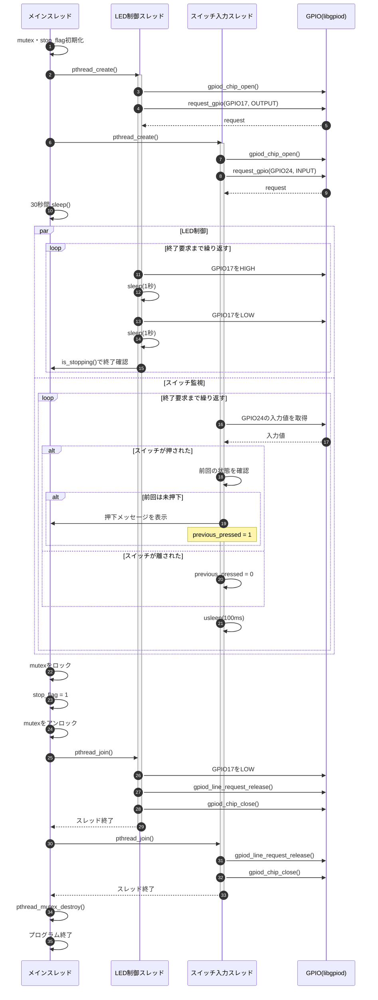
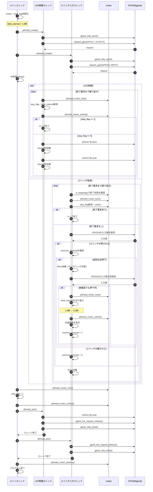

## 9. マルチスレッド(pthread)
本章では、pthreadを使用したマルチスレッド処理について説明する。

pthreadの基本的な仕組みや関数の使い方を確認し、複数のスレッドで処理を実行するプログラムを作成する。

また、スレッド間でのデータ共有や排他制御、GDBを使用したデバッグ方法について学習する。

### 9.1 pthreadとは

pthread（POSIX Threads）とは、LinuxなどのOSで
マルチスレッド処理を実現するための仕組みである。

#### プロセスとスレッドの違い

プロセスとは、実行中のプログラムと、その実行に必要な
メモリなどの資源を管理する単位である。

スレッドとは、プロセス内で処理を実行する単位である。
1つのプロセス内に複数のスレッドを作成することで、
複数の処理を並行して実行できる。

同じプロセス内のスレッドはメモリなどの資源を共有するため、
スレッド間でデータを共有できる。

#### Raspberry Pi Zero Wでpthreadを使用する理由

Raspberry Pi Zero WではLinuxが動作している。
Linuxはマルチスレッド処理に対応しており、
C言語からpthreadを使用してスレッドを作成・管理できる。

本手順書では、FreeRTOSを使用せず、
Linuxのpthreadを利用して複数の処理を並行して実行する。

### 9.2 pthreadを使用するプログラムの作成

pthreadを使用すると、1つのプログラム内で複数のスレッドを作成し、それぞれのスレッドで処理を実行できる。

ここでは、pthreadを使用するための基本的な関数と、プログラムの作成・コンパイル方法を説明する。

#### pthreadの基本的な関数

pthreadでは、主に次の関数を使用する。

| 関数 | 役割 |
| ---- | ---- |
| `pthread_create()` | 新しいスレッドを作成し、処理を開始する |
| `pthread_join()` | 指定したスレッドの終了を待つ |
| `pthread_mutex_lock()` | 排他制御を開始し、共有データへのアクセスを制限する |
| `pthread_mutex_unlock()` | 排他制御を解除する |

#### pthreadを使用したプログラムの作成

pthreadを使用するには、`pthread.h`をインクルードする。

```c
#include <stdio.h>
#include <pthread.h>

/* スレッドで実行する関数 */
void* thread_func(void* arg)
{
    printf("スレッドで処理を実行します。\n");

    return NULL;
}

int main(void)
{
    pthread_t thread;

    /* スレッドを作成する */
    pthread_create(&thread, NULL, thread_func, NULL);

    /* スレッドの終了を待つ */
    pthread_join(thread, NULL);

    printf("メインスレッドの処理を終了します。\n");

    return 0;
}
```

このプログラムでは、`pthread_create()`で新しいスレッドを作成し、`thread_func()`を実行する。

その後、`pthread_join()`で作成したスレッドの終了を待つ。

#### コンパイル方法

pthreadを使用するプログラムは、コンパイル時に`-pthread`オプションを指定する。

```bash
gcc -pthread -o thread_test thread_test.c　-lgpiod
```

| オプション | 役割 |
| ---- | ---- |
| `-pthread` | pthreadを使用するためのコンパイル・リンク設定を行う |
| `-o thread_test` | 出力する実行ファイル名を指定する |

コンパイル後、次のコマンドでプログラムを実行する。

```bash
./thread_test
```
### 9.3 題材5：複数タスク

#### プログラムの説明

ここでは、pthreadを使用して、LED制御とスイッチ入力を別々のスレッドで実行するプログラムを作成する。

それぞれのスレッドで実行する処理は次のとおりである。

| スレッド | 処理内容 |
| ---- | ---- |
| スレッド1 | LEDを一定間隔で点灯・消灯する |
| スレッド2 | スイッチの入力状態を監視する |

メインスレッドで2つのスレッドを作成し、それぞれの処理を並行して実行する。



#### 処理の流れ

プログラム全体の処理の流れを以下に示す。

1. メインスレッドでLED制御用のスレッドを作成する。
2. メインスレッドでスイッチ入力用のスレッドを作成する。
3. LED制御用のスレッドでLEDの点灯・消灯を繰り返す。
4. スイッチ入力用のスレッドでスイッチの状態を繰り返し確認する。
5. 各スレッドの終了後、メインスレッドで終了を待つ。

#### プログラムの作成

`pthread_create()`を使用して、LED制御用とスイッチ入力用のスレッドを作成する。

それぞれのスレッドでは、専用の関数を実行する。

また、`pthread_join()`を使用して、作成したスレッドの終了を待つ。

#### コンパイル・実行

pthreadを使用するため、コンパイル時に`-pthread`オプションを指定する。

```bash
gcc -pthread -o thread_test thread_test.c -lgpiod
```

コンパイル後、以下のコマンドでプログラムを実行する。

```bash
./thread_test
```

#### 動作確認

以下の動作を確認する。

- LEDが一定間隔で点灯・消灯すること。
- LEDの点灯・消灯中もスイッチの入力を受け付けること。
- プログラムを終了した際に、各スレッドが終了すること。

### 9.4 題材6：タスク間通信

#### プログラムの説明

ここでは、pthreadを使用して、スイッチの操作に応じてLEDの点滅速度を切り替えるプログラムを作成する。

それぞれのスレッドで実行する処理は次のとおりである。

| スレッド | 処理内容 |
| ---- | ---- |
| スレッド1 | LEDを点灯・消灯する |
| スレッド2 | スイッチの入力を監視し、LEDの点滅間隔を変更する |

スイッチ入力用のスレッドで変更した点滅間隔を、LED制御用のスレッドで参照することで、スレッド間でデータを共有する。



#### スレッド間のデータ共有

同じプロセス内のスレッドはメモリを共有するため、複数のスレッドから同じ変数にアクセスできる。

本プログラムでは、LEDの点滅間隔を共有変数として管理する。

| 共有変数 | 役割 |
| ---- | ---- |
| LEDの点滅間隔 | LED制御用スレッドが点滅間隔を参照し、スイッチ入力用スレッドが値を変更する |

複数のスレッドから同じ変数にアクセスする場合、データの読み書きが競合する可能性がある。

そのため、共有変数にアクセスする際には排他制御を行う。

#### 排他制御

排他制御とは、複数のスレッドが共有データに同時にアクセスしないように制御する仕組みである。

pthreadでは、mutexを使用して排他制御を行う。

| 関数 | 役割 |
| ---- | ---- |
| `pthread_mutex_lock()` | mutexをロックし、共有データへのアクセスを開始する |
| `pthread_mutex_unlock()` | mutexのロックを解除する |

共有変数を読み書きする際は、次の順番で処理する。

1. `pthread_mutex_lock()`でmutexをロックする。
2. 共有変数の値を読み取る、または変更する。
3. `pthread_mutex_unlock()`でmutexのロックを解除する。

これにより、共有変数へのアクセスを安全に行うことができる。

#### 処理の流れ

プログラム全体の処理の流れを以下に示す。

1. メインスレッドで共有変数とmutexを初期化する。
2. LED制御用のスレッドを作成する。
3. スイッチ入力用のスレッドを作成する。
4. LED制御用のスレッドで共有変数から点滅間隔を取得する。
5. スイッチ入力用のスレッドでスイッチの状態を確認する。
6. スイッチが操作された場合、mutexで排他制御を行い、共有変数の点滅間隔を変更する。
7. 各スレッドの終了後、メインスレッドで終了を待つ。

#### プログラムの作成

LED制御用のスレッドとスイッチ入力用のスレッドを作成する。

共有変数へのアクセスにはmutexを使用する。

LED制御用のスレッドでは、点滅間隔を取得した後にmutexのロックを解除してから、LEDの点灯・消灯や待機処理を行う。

#### コンパイル・実行

pthreadを使用するため、コンパイル時に`-pthread`オプションを指定する。

```bash
gcc -pthread -o thread_test thread_test.c -lgpiod
```

コンパイル後、以下のコマンドでプログラムを実行する。

```bash
./thread_test
```

#### 動作確認

以下の動作を確認する。

- LEDが点滅すること。
- 白スイッチを操作するとLEDの点滅速度が切り替わること。
- スイッチの操作を繰り返しても正常に動作すること。
<--
### 9.5 GDBを使用したマルチスレッドのデバッグ

#### デバッグの説明

第6章で学習したGDBの操作を、pthreadを使用したプログラムにも適用する。

マルチスレッドのプログラムでは、複数のスレッドがそれぞれ処理を実行するため、GDBを使用して各スレッドの状態や実行位置を確認する。

#### GDBの操作

マルチスレッドのデバッグでは、主に次のコマンドを使用する。

| コマンド | 役割 |
| ---- | ---- |
| `info threads` | スレッドの一覧を表示する |
| `thread 2` | スレッドIDが2のスレッドに切り替える |
| `thread apply all bt` | すべてのスレッドのバックトレースを表示する |
| `break 関数名` | 指定した関数にブレークポイントを設定する |
| `continue` | 次のブレークポイントまで実行する |

#### 動作確認

以下の操作を行い、マルチスレッドのデバッグ方法を確認する。

1. デバッグ情報付きでプログラムをコンパイルする。
2. GDBを起動する。
3. `break`コマンドでスレッド内の関数にブレークポイントを設定する。
4. `run`コマンドでプログラムを実行する。
5. `info threads`コマンドでスレッドの一覧を確認する。
6. `thread`コマンドで確認したいスレッドに切り替える。
7. `thread apply all bt`コマンドですべてのスレッドの実行位置を確認する。
8. `continue`コマンドで次のブレークポイントまで実行する。
-->