<!--
  手順書テンプレート(全ボード共通)
  - このファイルをコピーして、ボードごとのフォルダに保存してから書き始める。
  - 章の番号と名前は変えない。該当しない章は消さずに「本ボードでは作成しない(理由:〜)」と書く。
  - ボード独自の内容は、第9章以降に追加章として書く。
  - このコメントはプレビューには表示されない。消さずに残してよい。
-->

# 【ボード名】開発手順書

| 項目 | 内容 |
|---|---|
| 対象ボード | |
| 開発言語 | |
| IDE・ツール | (名称とバージョン) |
| SDK・ライブラリ | (名称とバージョン) |
| 開発PCのOS | (例:Windows 11 24H2) |
| 最終検証日 | (yyyy/mm/dd) |

## 改版履歴

| 版 | 日付 | 担当者 | 内容 |
|---|---|---|---|
| 0.1 | (yyyy/mm/dd) | | 新規作成 |

---

## 0. 概要

### 0.1 この手順書でできること
<!-- 読者がこの手順書を最後まで進めると何ができるようになるかを書く -->

### 0.2 必要な機材

| 品名 | 数量 | 備考 |
|---|---|---|
| | | |

### 0.3 前提知識・事前準備
<!-- 既存の Git/GitHub 運用・Redmine 運用を参考に、前提とする知識と準備を書く -->

---

## 1. 開発環境構築

### 1.1 ツールのインストール
### 1.2 ドライバのインストール
### 1.3 インストールできたことの確認

## 2. シリアルターミナルの使い方

### 2.1 使用するツールと接続方法
### 2.2 通信設定(ポート、ボーレートなど)
### 2.3 動作確認

## 3. プロジェクト作成
本手順書でいう**プロジェクト**とは、プログラムの開発に使うファイルを1つの作業フォルダにまとめたものである。

### 3.1 新規プロジェクトの作成

開発 PC に作業フォルダを作成し、その中に `Makefile` と`ソースファイル(.c)`を用意する。<br>WinSCP で作業を Raspberry Pi Zero W に転送し、 WinSCP の両方のファイルが届いたことを確認する。
<br>

#### 【新規プロジェクトの作成手順】<br>
　今回の手順では、例として作業フォルダ名を `sample` 、ソースファイル名を `sample.c` とする。<br>

 > **手順前の準備**：Raspberry Pi Zero W に SSH 接続していない場合は、第 1 章の手順で開発 PC から接続する。<br>　　　　　　　※Raspberry Pi Zero W のターミナルは、転送したファイルの確認が終わるまで開いたままにする。
 <br>

#### 開発 PC に作業フォルダを作成する

1. 開発 PC のエクスプローラーを開く。<br>


2. 作業フォルダを作成する任意の場所に移動する。<br>
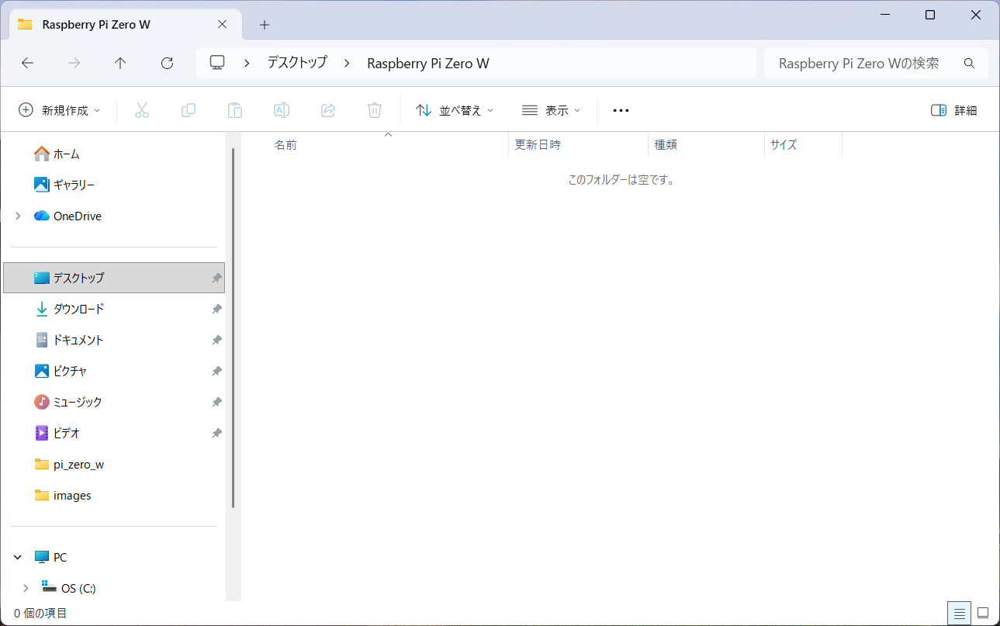<br>

3. エクスプローラーのファイル一覧の空いている場所を右クリックし、タブを開く。<br>
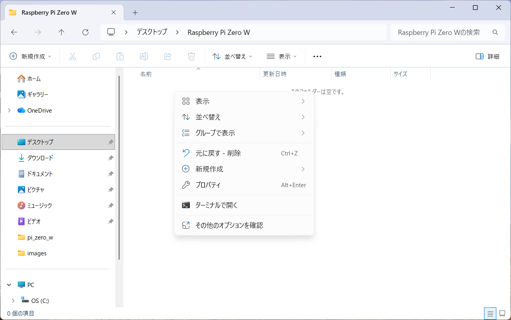<br>

4. 新規作成を選択する。<br>
<br>

5. フォルダーを選択する。<br>
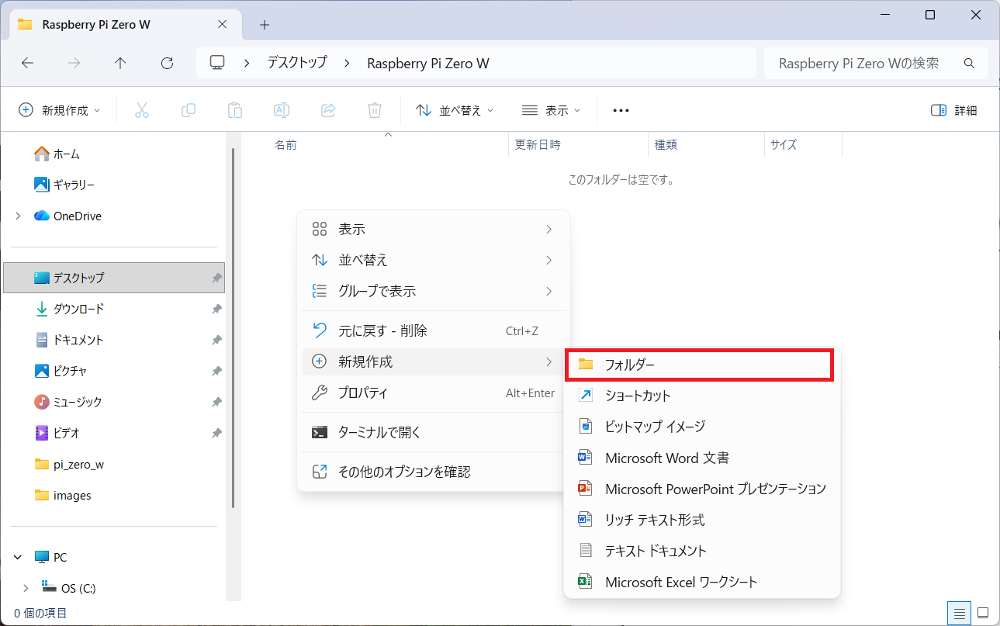<br>

6. 名前を `sample` でフォルダを作成する。<br>
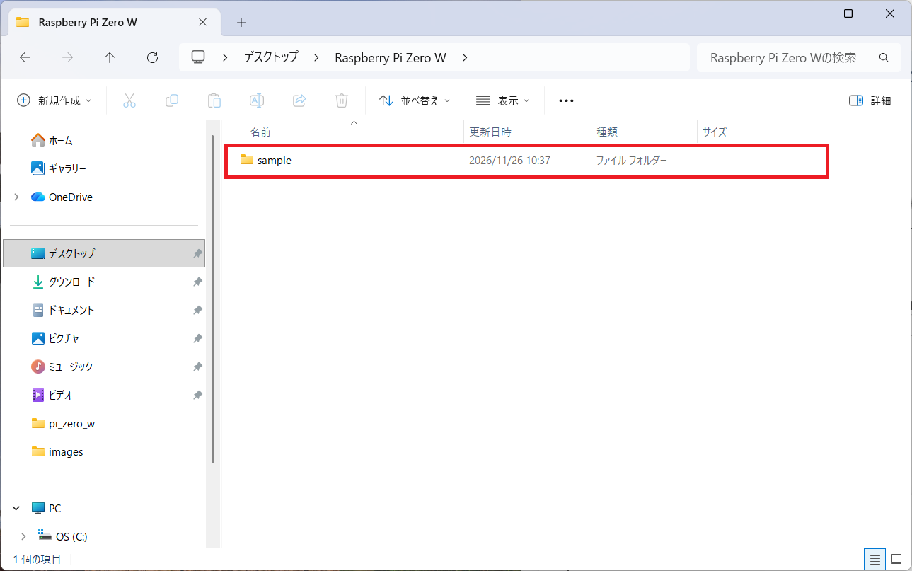<br>

#### VS Code で作業フォルダを開く

1. 開発 PC で VS Code を起動する。<br>

2. メニューバーの[ファイル]を選択する。<br>
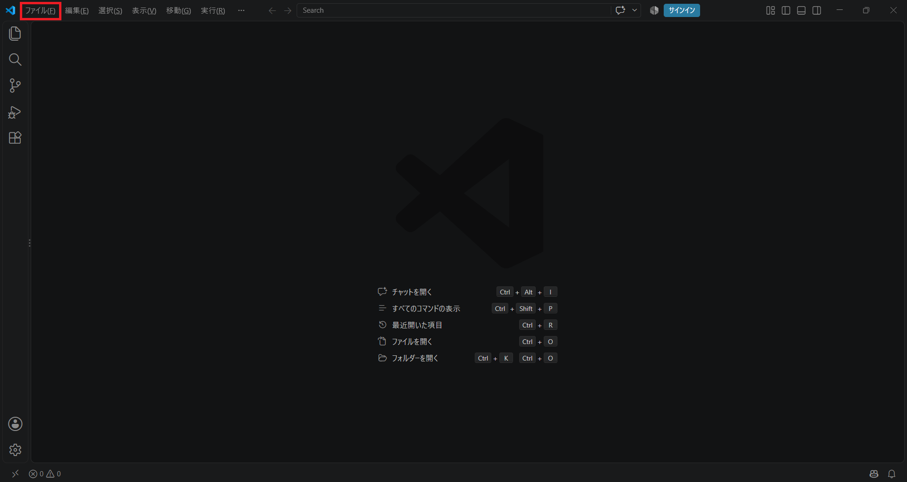<br>

3. [フォルダーを開く]を選択する。<br>
<br>

4. フォルダー選択画面で `sample` フォルダを選択する。<br>
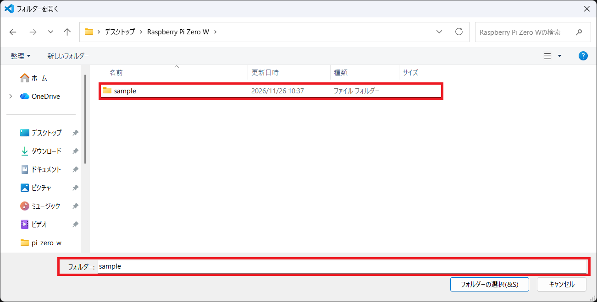<br>

5. [フォルダーの選択]をクリックする。<br>
<br>
　
   >　確認： VS Code のエクスプローラーに `sample` フォルダが表示されれば成功。<br><br>
   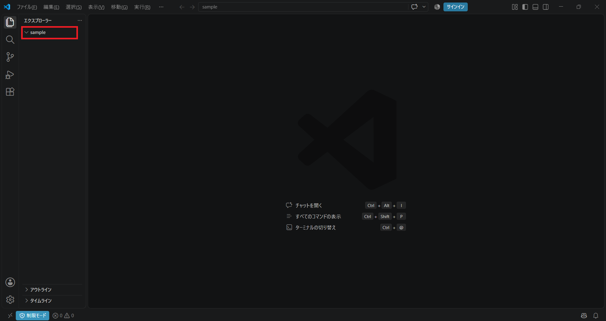
<br>

#### Makefile と ソースファイル(.c)を作成する

1. VS Code のエクスプローラーで、作業フォルダ名の横にある[新しいファイル]をクリックする。<br>
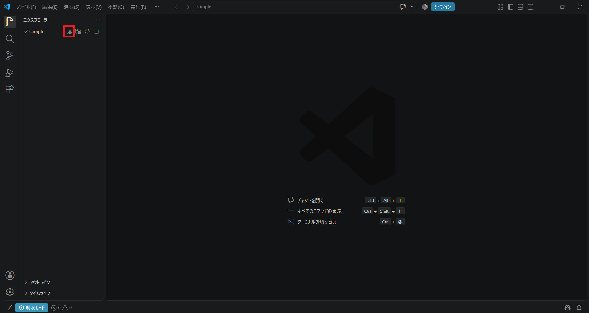<br>

2. ファイル名を `Makefile` で作成する。<br>※ファイル名は大文字の `M` で始め、拡張子は不要とする。<br>
<br>

3.  `Makefile` の編集画面に、次の内容を記述し、保存する。

      ```makefile
      # C のコンパイラ、言語規格、警告、デバッグ情報の設定
      CC = gcc
      CFLAGS += -std=c11 -Wall -Wextra -g

      # Raspberry Pi Zero W の GRaspberry Pi Zero WO を操作するライブラリの設定
      CPPFLAGS += $(shell pkg-config --cflags libgpiod)
      LDLIBS += $(shell pkg-config --libs libgpiod)

      # 作業フォルダ直下のソースファイル(.c)から実行ファイル名を求める
      SOURCES := $(wildcard *.c)
      PROGRAMS := $(SOURCES:.c=)

      .PHONY: all
      all: $(PROGRAMS)

      # .c からコンパイルされた .o とライブラリをリンクして実行ファイルを作る
      $(PROGRAMS): %: %.o ; $(CC) $(LDFLAGS) -o $@ $^ $(LDLIBS)
      ```

      >　確認： `Makefile` の内容が次のようになっていれば成功。<br>
      <br>

<br>

4. VS Code のエクスプローラーで、再度[新しいファイル]をクリックする。<br>
<br>

5. ファイル名を `sample.c` で作成する。<br>※プログラムは後で記述するため、この時点では空のファイルでよい。<br>
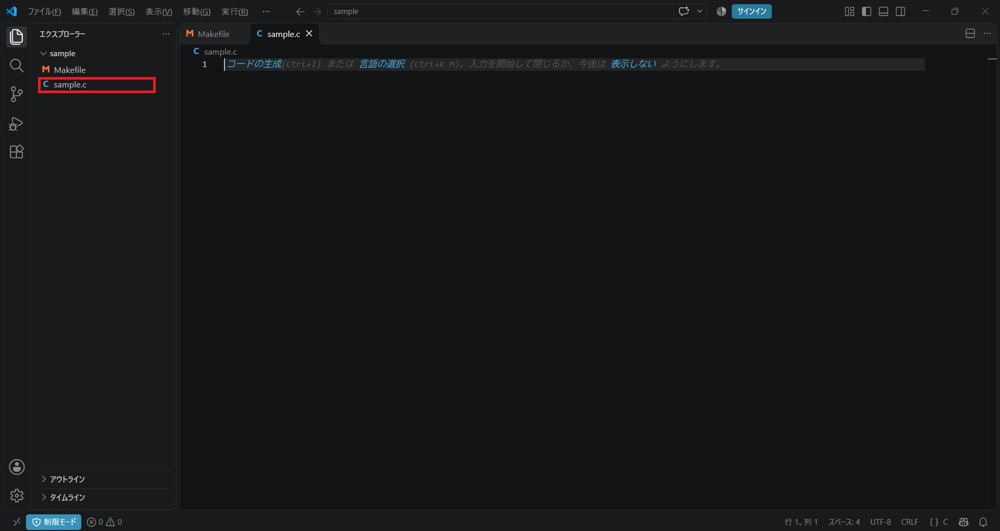<br>

   >　確認： 作業フォルダの直下に `Makefile` と `sample.c` が並んで表示されていれば成功。<br><br>
   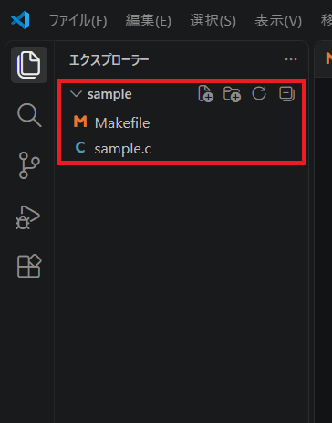<br>


####  WinSCP で Raspberry Pi Zero W に接続する

1. 開発 PC で WinSCP を起動する。<br>

2. ログイン画面で[新しいサイト]を選択する。<br>
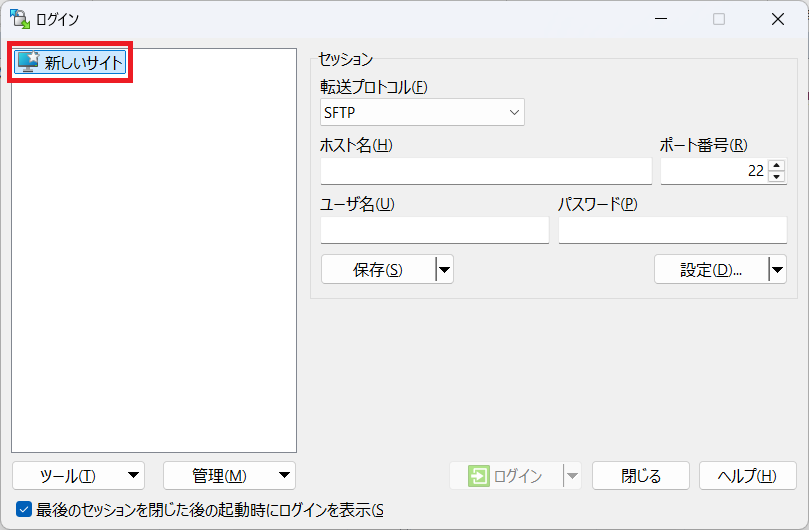<br>

3. セッションの[転送プロトコル]で `SCP` を選択する。<br>
<br>

4. [ホスト名]に、**1.1.1 Raspberry Pi Imager のインストール**で設定した `hostname` を設定する。<br>
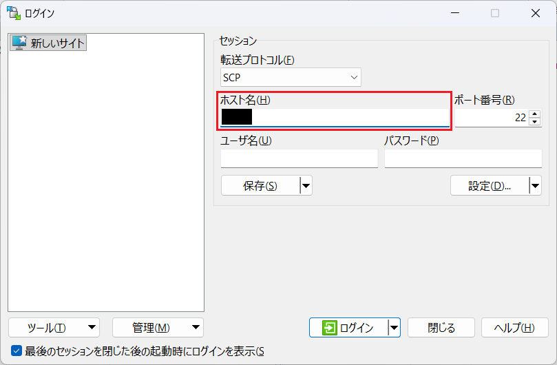<br>

5. [ポート番号]に、標準のSSHポートである `22` を設定する。<br>
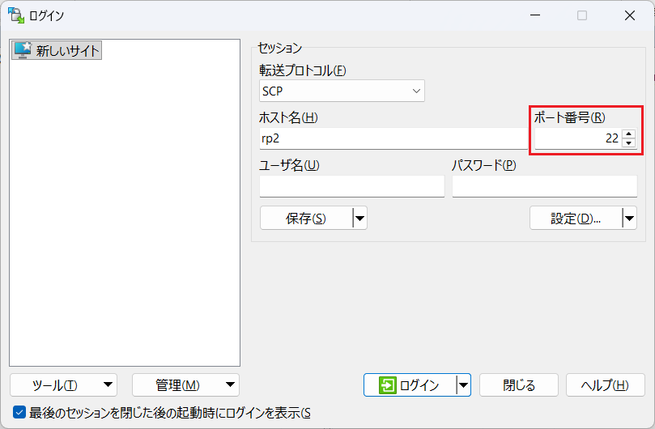<br>

6. [ユーザー名]に、**1.1.1 Raspberry Pi Imager のインストール**で設定した `username` を設定する。<br>
<br>

7. [保存]をクリックする。
<br>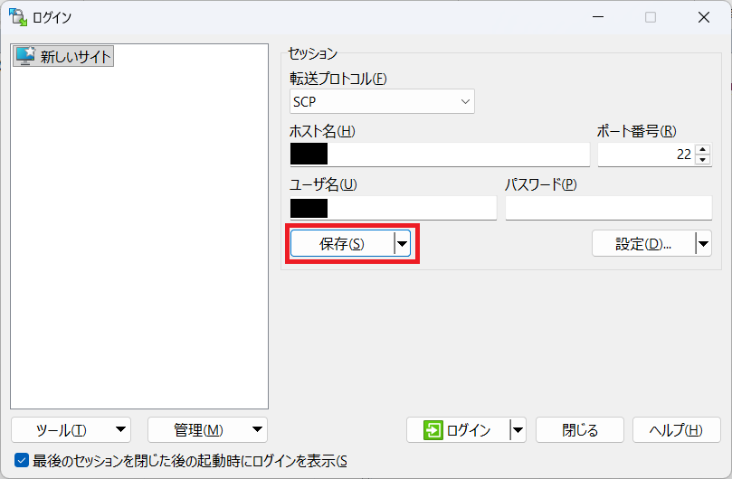<br>

8. [セッションの保存名]を入力する。<br>※今回の手順では、 `Raspberry Pi Zero W` と入力する。
<br>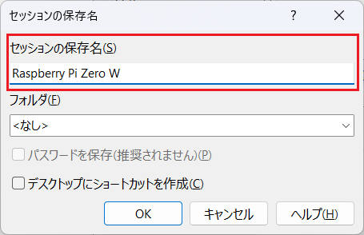<br>

9. [OK]をクリックしてセッションを保存する。<br>
<br>

   >　確認： ログイン画面の左側の一覧から、保存した `Raspberry Pi Zero W` が表示されていれば成功。<br><br>
   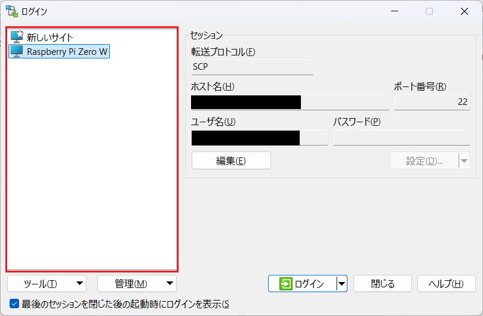<br>

10. ログイン画面の左側の一覧から、保存した `Raspberry Pi Zero W` を選択する。
<br><br>

11. [ログイン]をクリックする。<br>
※パスワードの入力を求められた場合は、**1.1.1 Raspberry Pi Imager のインストール**で設定したログインユーザーのパスワードを入力する。<br>
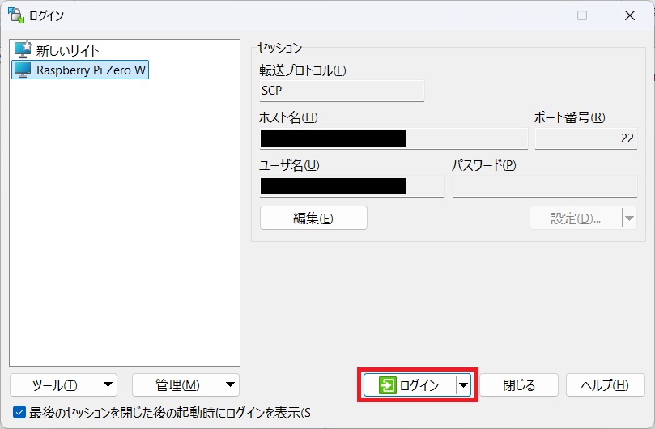<br>

      >　確認：  WinSCP のリモート側(右側)に Raspberry Pi Zero W のファイル一覧が表示されれば接続成功。<br>
      <br>

####  作業フォルダを転送する
1. WinSCP のリモート側で、ログインユーザーのホームフォルダを表示する。今回の手順では、ユーザー名を `pi` 、ホームフォルダを `/home/pi` とする。<br>
 別の場所が表示されている場合は、リモート側の一覧をクリックして `Ctrl` + `O` を押し、表示されたダイアログにホームフォルダのパスを入力して開く。<br>
<br>

<br>

2. 開発 PC のエクスプローラーで、`sample` フォルダが見えるように、その 1 つ上のフォルダを表示する。<br>
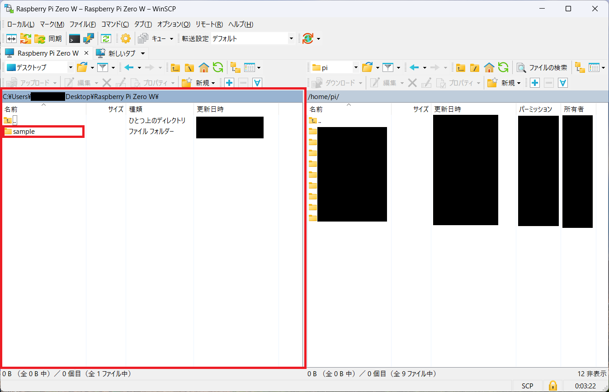<br>

3. エクスプローラーから `sample` フォルダをドラッグし、WinSCP のリモート側のファイル一覧の空いている場所にドロップする。<br>
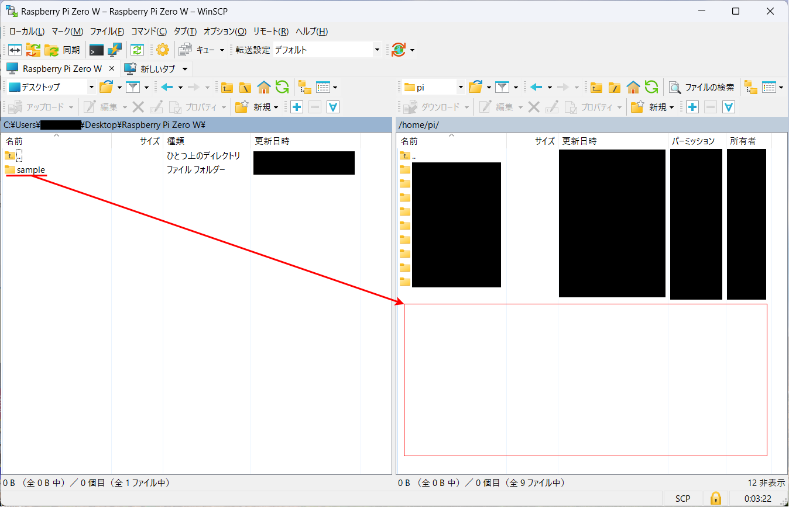<br>
      >　注意： 別のフォルダのアイコンに重ねると、そのフォルダが転送先になる。転送先に同名のファイルがある場合は、上書きするファイルを確認する。<br>


4. アップロード画面の「OK」を選択し、転送を開始する。<br>
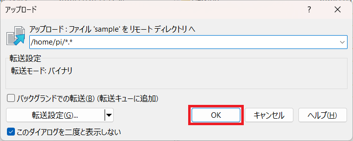<br>

   >　確認： 転送先のリモートディレクトリのパスがあっているかを確認。<br>
   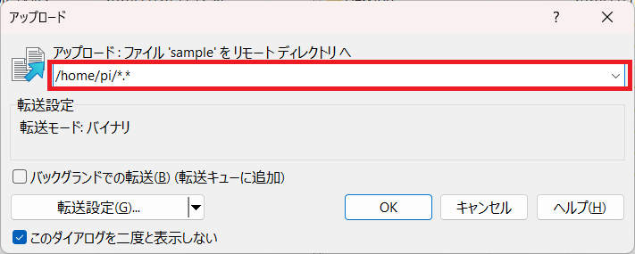<br>

5. 転送が終わったら、WinSCP のリモート側に sample フォルダが表示されたことを確認する。<br>
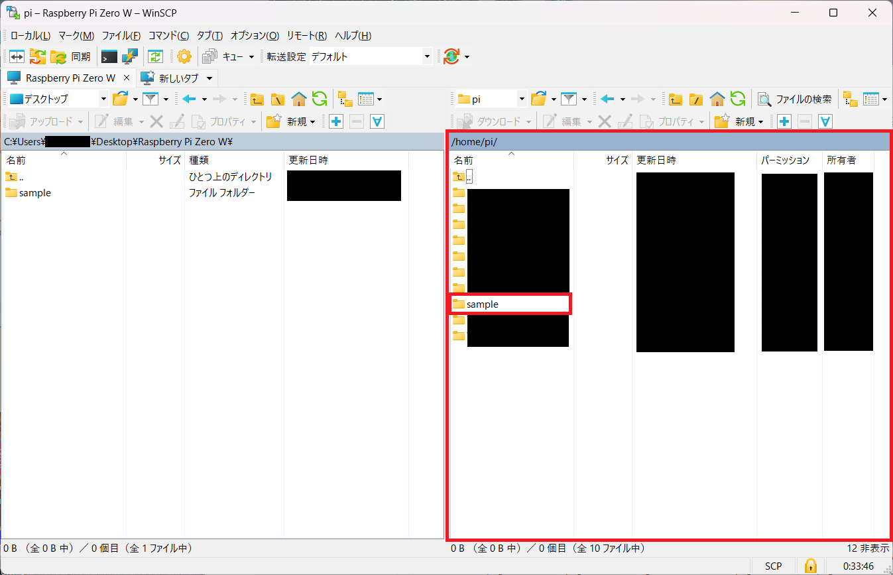<br>
      >　確認： Raspberry Pi Zero W 側の `sample` フォルダに `Makefile` と `sample.c` の両方が表示されれば、新規プロジェクトの作成は完了。<br><br>

####  Raspberry Pi Zero W 側で転送したファイルを確認する

1. WinSCP のリモート側で、転送した `sample` フォルダを開く。<br>
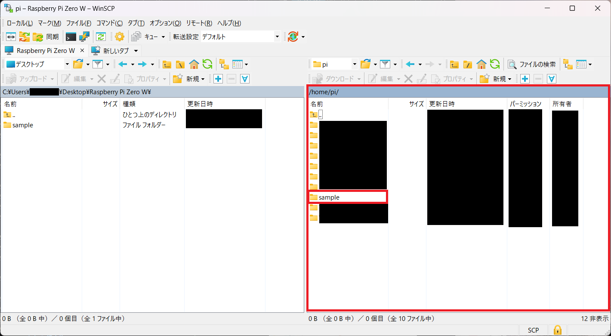<br>

2. 開発 PC のエクスプローラーで `sample` フォルダを開く。<br>
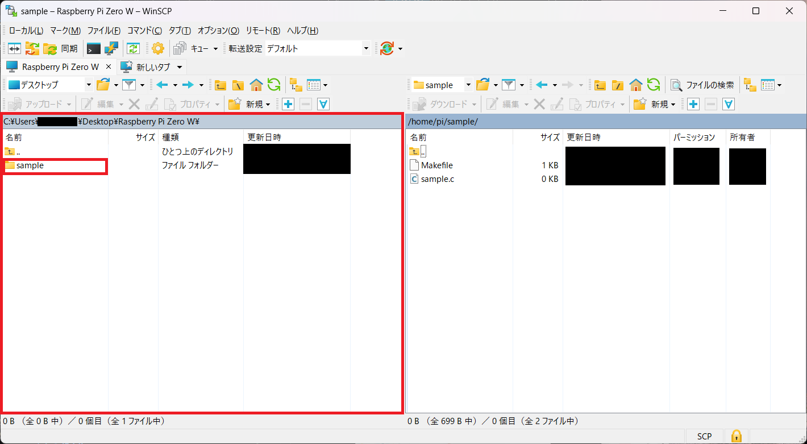<br>

3. 開発 PC と WinSCP のリモート側のファイル一覧を見比べる。<br>
<br>


### 3.2 プロジェクトの構成（フォルダ・ファイルの役割）
本プロジェクトでは、開発 PC でプログラムを作成・編集し、Raspberry Pi Zero W 上でビルドして動作を確認する。<br>`ソースファイル(.c)`とビルド手順を記述した `Makefile` を 1 つの作業フォルダにまとめ、フォルダごと Raspberry Pi Zero W に転送できるように構成している。<br>
次の表に、開発 PC と Raspberry Pi Zero W における作業フォルダと各ファイルの役割を示す。

| フォルダ　　| 開発 PC での役割 | Raspberry Pi Zero W での役割 |
| --- | --- | --- |
| 作業フォルダ | プロジェクトで使うファイルをまとめて編集する場所。| 転送したファイルを受け取り、ビルドや実行を行う場所。 |
<br>

| ファイル　| 開発 PC での役割 | Raspberry Pi Zero W での役割 |
| --- | --- | --- |
| Makefile | 実行ファイルを作るために使うファイルとコマンドを記述する。 | `make` がこのファイルを読み、ビルドに必要なコマンドを実行する。 |
| ソースファイル(.c) | プログラムの処理をC言語で記述する。 | `gcc` がオブジェクトファイル(`.o`)に変換する。この処理をコンパイルという。|
| オブジェクトファイル(.o) | ― | コンパイルで生成される中間ファイル。これをGPIO操作用のライブラリ `libgpiod` と結び付けて実行ファイルを作る処理をリンクという。 |
| 実行ファイル | ― | リンクによって作業フォルダに生成される。このファイルを起動して、プログラムの動作を確認する。 |
<br>

## 4. コーディング・ビルド・書込み(RTOSなし)

本章では、Raspberry Pi Zero W と IoT 学習 HAT を使い、「LED 点滅」「ボタン入力」「UART 出力」「タイマ割込み」の 4 つの題材に取り組む。

**各題材に共通する作業の流れ**

第 3 章で用意した作業フォルダと `Makefile` を使う。ソースを修正したときは、保存したファイルを再転送してからビルドする。

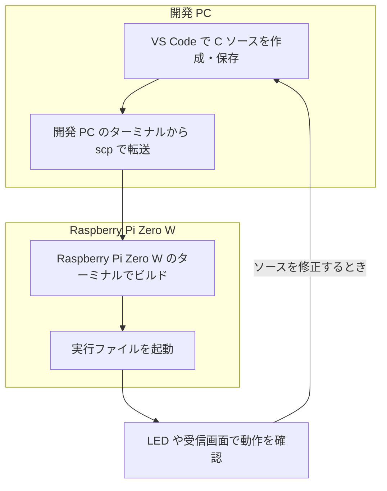


### 4.1 題材1: LED点滅

事前準備

#### ① 作るもの

Raspberry Pi Zero W でプログラムを実行すると、IoT 学習 HAT の赤 LED が 0.5 秒間の点灯と 0.5 秒間の消灯を繰り返す。

#### ② 配線

第 1 章で取り付けた HAT を使用する。赤 LED は GPIO17（物理ピン 11）につながっており、研修用 HAT では High で点灯する。

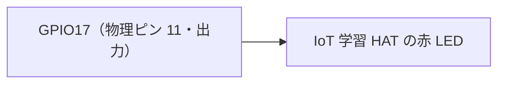

#### ③ プログラム

1. **Raspberry Pi Zero W のターミナル**で `pkg-config --modversion libgpiod` を実行する。HAT の GPIO 操作に使う `libgpiod` のバージョンを調べる。

   表示が `2.` で始まることを確認する。`1.` で始まる場合やエラーが表示される場合は、第 1 章の使用環境を確認する。

2. 開発 PC の VS Code で、3.1 節で作成した作業フォルダを開く。次のコードを入力し、作業フォルダの直下に `led_blink.c` として保存する。`blink_led` で、`nanosleep` による 0.5 秒の待機をはさみながら LED の出力を切り替える。

   ```c
    #define _POSIX_C_SOURCE 200809L
    #include <gpiod.h>
    #include <stdlib.h>
    #include <time.h>

    #define CHIP_PATH "/dev/gpiochip0"
    #define LED_PIN 17U
    #define BLINK_COUNT 5
    #define HALF_SECOND_NS 500000000L
    int main(void) {
        const unsigned int offset = LED_PIN;
        const struct timespec interval = { .tv_sec = 0, .tv_nsec = HALF_SECOND_NS };
        struct gpiod_chip *chip = gpiod_chip_open(CHIP_PATH);
        if (chip == NULL) {
            return EXIT_FAILURE;
        }
    struct gpiod_line_settings *settings = gpiod_line_settings_new();
    struct gpiod_line_config *config = gpiod_line_config_new();
    int result = EXIT_FAILURE;

    // GPIO17 を出力にし、使い始めたときに赤 LED を点灯する。
    if (settings == NULL || config == NULL) {
        goto cleanup;
    }
    if (gpiod_line_settings_set_direction(settings, GPIOD_LINE_DIRECTION_OUTPUT) < 0 ||
        gpiod_line_settings_set_output_value(settings, GPIOD_LINE_VALUE_ACTIVE) < 0 ||
        gpiod_line_config_add_line_settings(config, &offset, 1U, settings) < 0) {
        goto cleanup;
    }
    struct gpiod_line_request *request = gpiod_chip_request_lines(chip, NULL, config);
    if (request == NULL) {
        goto cleanup;
    }

    // 点灯と消灯を 0.5 秒ずつ、5 回繰り返す。
    result = EXIT_SUCCESS;
    for (int count = 0; count < BLINK_COUNT; ++count) {
        if (gpiod_line_request_set_value(request, LED_PIN, GPIOD_LINE_VALUE_ACTIVE) < 0) {
            result = EXIT_FAILURE;
            break;
        }

        const int on_wait = nanosleep(&interval, NULL);
        const int off_result = gpiod_line_request_set_value(request, LED_PIN,
        GPIOD_LINE_VALUE_INACTIVE);
        if (on_wait < 0 || off_result < 0 || nanosleep(&interval, NULL) < 0) {
            result = EXIT_FAILURE;
            break;
            }
        }
    cleanup:
        if (config != NULL) {
            gpiod_line_config_free(config);
        }
        if (settings != NULL) {
            gpiod_line_settings_free(settings);
        }
        gpiod_chip_close(chip);
        return result;
    }
   ```

#### ④ ビルドと書込み

1. 作業フォルダの 1 つ上のフォルダを開いた **開発 PC のターミナル**で、`led_blink.c` を Raspberry Pi Zero W に転送する。

   ```powershell
   scp ".\フォルダ名\led_blink.c" "ユーザー名@ホスト名:フォルダ名/"
   ```

2. **Raspberry Pi Zero W のターミナル**で、転送先の作業フォルダに移動する。

   ```bash
   cd ~/"フォルダ名"
   ```

3. 同じターミナルでビルドする。コマンドがエラーなく終わり、実行ファイル `led_blink` が表示されればビルド完了。

   ```bash
   make led_blink && ls -l led_blink
   ```

4. **Raspberry Pi Zero W のターミナル**で、実行ファイルを起動する。末尾の `high` は、赤 LED が High で点灯する設定である。

   ```bash
   ./led_blink /dev/gpiochip0 high
   ```

#### ⑤ 動作確認
Tera Term の SSH 画面で ./led_blink を実行する。赤 LED が約 0.5 秒の点灯と約 0.5 秒の消灯を 5 回繰り返し、最後に消灯してコマンドの入力待ちに戻れば成功。<br>


### 4.2 題材2:ボタン入力

- **①作るもの:** 白スイッチを押している間だけ赤LEDを点灯
- **②配線:** LED1(赤) = BCM 17, SW1(白スイッチ) = 24
- **③プログラム:** 使うライブラリ gpiod

<details>
    <summary>no2.c</summary>

```C
#define _POSIX_C_SOURCE 200809L

#include <stdio.h>
#include <stdbool.h>
#include <signal.h>
#include <time.h>
#include <gpiod.h>

#define CHIP_PATH   "/dev/gpiochip0"
#define LED1        17U
#define SW1         24U
#define SLEEP_TIME  50000000L

static volatile sig_atomic_t stop_flag = 0;

void signal_handler(int signal_number)
{
    (void)signal_number;
    stop_flag = 1;
}

int main(void)
{
    const unsigned int led_offset = LED1;
    const unsigned int sw_offset = SW1;
    const struct timespec interval = {
        .tv_sec = 0,
        .tv_nsec = SLEEP_TIME
    };

    struct gpiod_chip *chip = gpiod_chip_open(CHIP_PATH);
    struct gpiod_line_settings *settings = gpiod_line_settings_new();
    struct gpiod_line_config *config = gpiod_line_config_new();
    struct gpiod_line_request *request = NULL;

    bool current_state;
    bool last_state = false;

    // LEDを出力に設定
    gpiod_line_settings_set_direction(settings, GPIOD_LINE_DIRECTION_OUTPUT);
    gpiod_line_settings_set_output_value(settings, GPIOD_LINE_VALUE_INACTIVE);
    gpiod_line_config_add_line_settings(config, &led_offset, 1U, settings);

    // SWを入力に設定
    gpiod_line_settings_set_direction(settings, GPIOD_LINE_DIRECTION_INPUT);
    gpiod_line_settings_set_bias(settings, GPIOD_LINE_BIAS_PULL_DOWN);
    gpiod_line_config_add_line_settings(config, &sw_offset, 1U, settings);

    // GPIOラインを要求
    request = gpiod_chip_request_lines(chip, NULL, config);

    signal(SIGINT, signal_handler);

    printf("SW1を押す:LED1(赤)点灯\n");
    printf("Ctrl+C:プログラム終了\n");

    while (!stop_flag) {

        // SWの状態を取得
        int sw_value = gpiod_line_request_get_value(request, sw_offset);

        current_state = (sw_value == GPIOD_LINE_VALUE_ACTIVE);

        // LEDの状態を設定
        int led_value = current_state
            ? GPIOD_LINE_VALUE_ACTIVE
            : GPIOD_LINE_VALUE_INACTIVE;

        gpiod_line_request_set_value(request, led_offset, led_value);

        // OFFからONに変化した場合
        if (current_state && !last_state) {
            printf("LED点灯\n");
        }

        last_state = current_state;

        // 50ms待機
        nanosleep(&interval, NULL);
    }

    printf("\n動作を終了します。\n");

    // cleanup
    gpiod_line_request_set_value(request, led_offset, GPIOD_LINE_VALUE_INACTIVE);
    gpiod_line_request_release(request);
    gpiod_line_config_free(config);
    gpiod_line_settings_free(settings);
    gpiod_chip_close(chip);

    return 0;
}

```

</details>

- **④ ビルドと書込み**

1. 作業フォルダの 1 つ上のフォルダを開いた **開発 PC のターミナル**で、`no2.c` を Raspberry Pi Zero W に転送する。

   ```powershell
   scp ".\フォルダ名\no2.c" "ユーザー名@ホスト名:フォルダ名/"
   ```

2. **Raspberry Pi Zero W のターミナル**で、転送先の作業フォルダに移動する。

   ```bash
   cd ~/"フォルダ名"
   ```

3. 同じターミナルでビルドする。コマンドがエラーなく終わり、実行ファイル `no2` が表示されればビルド完了。

   ```bash
   make no2 && ls -l no2
   ```

4. **Raspberry Pi Zero W のターミナル**で、実行ファイルを起動する。

   ```bash
   ./no2
   ```

- **⑤動作確認:**


> 確認: 白スイッチを押すとRaspberry Pi基盤上の赤LEDが点灯し、CLI上に"LED点灯"と出力されることを確認する。

### 4.3 題材3:UART出力


- **①作るもの:** 白スイッチを押した回数をパソコンに表示する
- **②配線:** LED1(赤) = SW1(白スイッチ) = 24
- **③プログラム:** 使うライブラリ gpiozero, pyserial

<details>
    <summary>no3.c</summary>

```C
#define _POSIX_C_SOURCE 200809L
#define _DEFAULT_SOURCE

#include <gpiod.h>
#include <stdio.h>
#include <signal.h>
#include <fcntl.h>
#include <unistd.h>
#include <termios.h>
#include <time.h>

#define CHIP_PATH   "/dev/gpiochip0"
#define SW1         24U
#define UART_PATH   "/dev/ttyS0"
#define BAUDRATE    B115200

#define MESSAGE     "ボタン押下検知"

volatile sig_atomic_t stop_flag = 0;

void signal_handler(int signal_no)
{
    (void)signal_no;
    stop_flag = 1;
}

int main(void)
{
    unsigned int sw1 = SW1;

    struct gpiod_chip *chip = NULL;
    struct gpiod_line_settings *settings = NULL;
    struct gpiod_line_config *config = NULL;
    struct gpiod_line_request *request = NULL;
    struct gpiod_request_config *request_config = NULL;

    struct termios uart_settings;
    int uart_fd = -1;
    int value;
    int count = 0;
    char data[32];
    int data_size;

    struct timespec delay = {0, 100000000L};

    signal(SIGINT, signal_handler);

    /* UART初期化 */
    uart_fd = open(UART_PATH, O_RDWR | O_NOCTTY);

    tcgetattr(uart_fd, &uart_settings);

    cfmakeraw(&uart_settings);
    cfsetispeed(&uart_settings, BAUDRATE);
    cfsetospeed(&uart_settings, BAUDRATE);

    uart_settings.c_cflag |= (CLOCAL | CREAD);
    uart_settings.c_cflag &= ~CSTOPB;
    uart_settings.c_cflag &= ~PARENB;
    uart_settings.c_cflag &= ~CSIZE;
    uart_settings.c_cflag |= CS8;

    tcsetattr(uart_fd, TCSANOW, &uart_settings);

    tcflush(uart_fd, TCOFLUSH);
    nanosleep(&(struct timespec){1, 0}, NULL);

    /* GPIO初期化 */
    chip = gpiod_chip_open(CHIP_PATH);
    settings = gpiod_line_settings_new();
    config = gpiod_line_config_new();

    gpiod_line_settings_set_direction(settings, GPIOD_LINE_DIRECTION_INPUT);
    gpiod_line_settings_set_bias(settings, GPIOD_LINE_BIAS_PULL_DOWN);
    gpiod_line_config_add_line_settings(config, &sw1, 1, settings);
    request = gpiod_chip_request_lines(chip, request_config, config);

    /* ボタン押下検知 */
    while (!stop_flag) {
        nanosleep(&delay, NULL);

        value = gpiod_line_request_get_value(request, SW1);

        if (value == 1) {
            count++;

            printf("%s\n", MESSAGE);

            data_size = snprintf(data, sizeof(data),"Count:%d\r\n", count);

            write(uart_fd, data, (size_t)data_size);

            /* ボタンが離されるまで待機 */
            while (!stop_flag) {
                value = gpiod_line_request_get_value(request, SW1);

                if (value == 0) {
                    break;
                }

                nanosleep(&(struct timespec){0, 50000000L}, NULL);
            }
        }
    }

    printf("\n終了\n");

    // clean up
    gpiod_line_request_release(request);
    gpiod_line_config_free(config);
    gpiod_line_settings_free(settings);
    gpiod_chip_close(chip);
    close(uart_fd);

    return 0;
}

```

</details>

- **④ ビルドと書込み**

1. 作業フォルダの 1 つ上のフォルダを開いた **開発 PC のターミナル**で、`no3.c` を Raspberry Pi Zero W に転送する。

   ```powershell
   scp ".\フォルダ名\no3.c" "ユーザー名@ホスト名:フォルダ名/"
   ```

2. **Raspberry Pi Zero W のターミナル**で、転送先の作業フォルダに移動する。

   ```bash
   cd ~/"フォルダ名"
   ```

3. 同じターミナルでビルドする。コマンドがエラーなく終わり、実行ファイル `no3` が表示されればビルド完了。

   ```bash
   make no3 && ls -l no3
   ```

4. **Raspberry Pi Zero W のターミナル**で、実行ファイルを起動する。

   ```bash
   ./no2
   ```

- **⑤動作確認:**

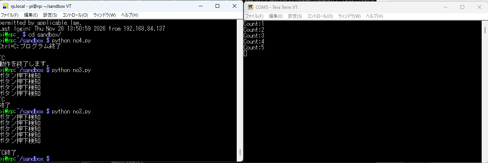

> 確認: 白スイッチを押すと、CLI上に"ボタン押下検知"と出力されることを確認する。シリアル通信のCLI上に押下回数が出力されることを確認する。

### 4.4 題材4:タイマ割込み

- **①作るもの:** 一定の周期で赤LEDを点滅
- **②配線:** LED1(赤) = 17
- **③プログラム:** 使うライブラリ gpiod

<details>
    <summary>no4.c</summary>

```C
#define _POSIX_C_SOURCE 200809L

#include <stdio.h>
#include <stdbool.h>
#include <signal.h>
#include <stdint.h>
#include <unistd.h>
#include <errno.h>
#include <time.h>
#include <sys/timerfd.h>
#include <gpiod.h>

#define CHIP_PATH       "/dev/gpiochip0"
#define LED1            17U
#define TIMER_SEC       0
#define TIMER_NSEC      500000000L

static volatile sig_atomic_t stop_flag = 0;

void signal_handler(int signal_number)
{
    (void)signal_number;
    stop_flag = 1;
}

int main(void)
{
    const unsigned int led_offset = LED1;

    const struct itimerspec timer = {
        .it_value = {
            .tv_sec = TIMER_SEC,
            .tv_nsec = TIMER_NSEC
        },
        .it_interval = {
            .tv_sec = TIMER_SEC,
            .tv_nsec = TIMER_NSEC
        }
    };

    struct gpiod_chip *chip = gpiod_chip_open(CHIP_PATH);
    struct gpiod_line_settings *settings = gpiod_line_settings_new();
    struct gpiod_line_config *config = gpiod_line_config_new();
    struct gpiod_line_request *request = NULL;

    bool led_state = false;
    uint64_t total;
    int timer_fd = -1;

    // LEDを出力に設定し、初期状態を消灯にする
    gpiod_line_settings_set_direction(settings, GPIOD_LINE_DIRECTION_OUTPUT);
    gpiod_line_settings_set_output_value(settings, GPIOD_LINE_VALUE_INACTIVE);
    gpiod_line_config_add_line_settings(config, &led_offset, 1U, settings);

    // GPIOラインを要求
    request = gpiod_chip_request_lines(chip, NULL, config);

    // タイマーを作成
    timer_fd = timerfd_create(CLOCK_MONOTONIC, 0);

    // 初回0.5秒、以降0.5秒間隔でタイマーを設定
    timerfd_settime(timer_fd, 0, &timer, NULL);

    signal(SIGINT, signal_handler);

    printf("Ctrl+C:プログラム終了\n");

    while (!stop_flag) {

        // タイマー通知を読み取る
        ssize_t read_size = read(timer_fd, &total, sizeof(total));

        // タイマー通知があればLEDを反転
        if (total != 0U) {
            led_state = !led_state;

            int led_value = led_state
                ? GPIOD_LINE_VALUE_ACTIVE
                : GPIOD_LINE_VALUE_INACTIVE;

            gpiod_line_request_set_value(request, led_offset, led_value);
        }
    }

    printf("\n動作を終了します。\n");

    // cleanup
    gpiod_line_request_set_value(request, led_offset, GPIOD_LINE_VALUE_INACTIVE);
    gpiod_line_request_release(request);
    close(timer_fd);
    gpiod_line_config_free(config);
    gpiod_line_settings_free(settings);
    gpiod_chip_close(chip);

    return 0;
}

```

</details>

- **④ ビルドと書込み**

1. 作業フォルダの 1 つ上のフォルダを開いた **開発 PC のターミナル**で、`no4.c` を Raspberry Pi Zero W に転送する。

   ```powershell
   scp ".\フォルダ名\no4.c" "ユーザー名@ホスト名:フォルダ名/"
   ```

2. **Raspberry Pi Zero W のターミナル**で、転送先の作業フォルダに移動する。

   ```bash
   cd ~/"フォルダ名"
   ```

3. 同じターミナルでビルドする。コマンドがエラーなく終わり、実行ファイル `no4` が表示されればビルド完了。

   ```bash
   make no4 && ls -l no4
   ```

4. **Raspberry Pi Zero W のターミナル**で、実行ファイルを起動する。

   ```bash
   ./no4
   ```

- **⑤動作確認:**


> 確認: 一定周期で赤LEDが点灯できていることを確認する。


## 5. コーディング・ビルド・書込み(FreeRTOS)

### 5.1 FreeRTOSの導入・設定
### 5.2 題材5:複数タスク
### 5.3 題材6:タスク間通信

## 6. デバッグ

### 6.1 デバッガの接続(配線図・写真)
### 6.2 デバッグの開始
### 6.3 ブレークポイント・ステップ実行
### 6.4 変数・メモリ・レジスタの確認

## 7. トラブルシューティング

| 症状 | 原因 | 対処 |
|---|---|---|
| | | |

## 8. 参考資料

- 

<!-- ボード独自の追加章がある場合は、ここから「## 9. 〜」として追加する -->

<!--
  記述ルール(書きぶりを全章でそろえる)
  1. 見出し:章は「## 1. 開発環境構築」、節は「### 1.1 ツールのインストール」の形にする。
  2. 手順:番号付きリストで書き、1つの番号に1つの操作。文末は「〜する。」にそろえる。
  3. 確認:手順のあとに「> 確認:〜れば成功」と、成功したかどうかの判断方法を書く。
  4. 注意:まちがえやすい所は「> 注意:〜」と書く。
  5. 画像:画面操作にはスクリーンショットを付ける。images/ に置き、名前は担当番号から始める(例:p1_ext.png)。
  6. 図:処理の流れやタスクの関係は Mermaid で書く。配線は図か写真で、ピン番号と信号名を書く。
  7. プログラム:手順書の中にコードブロックで書き、日本語のコメントを付ける。
  8. バージョン:ツールと SDK のバージョンを書く。
  9. 用語:同じものは同じことばで書く。英数字は半角で、日本語との間に半角スペースを入れる。
  10. つまずいた点:第7章に必ず記録する。
-->
